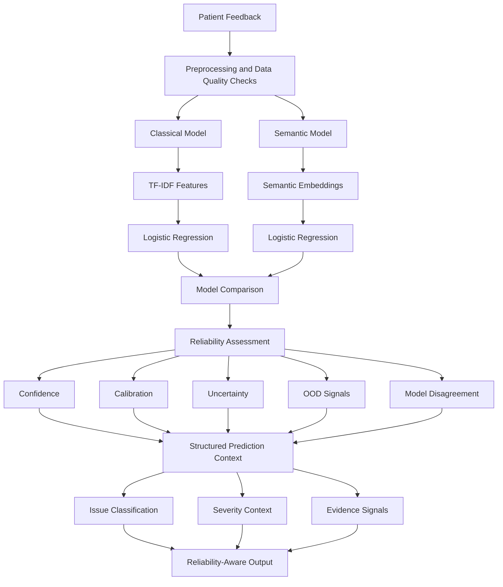
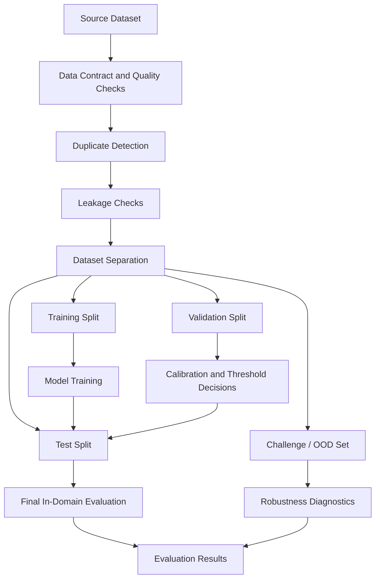
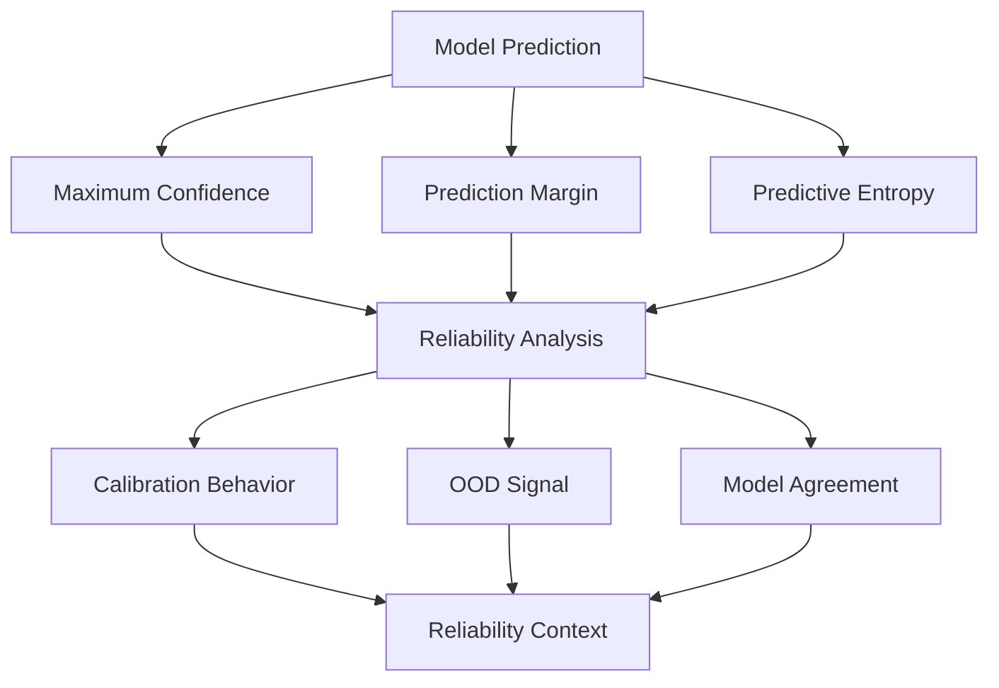
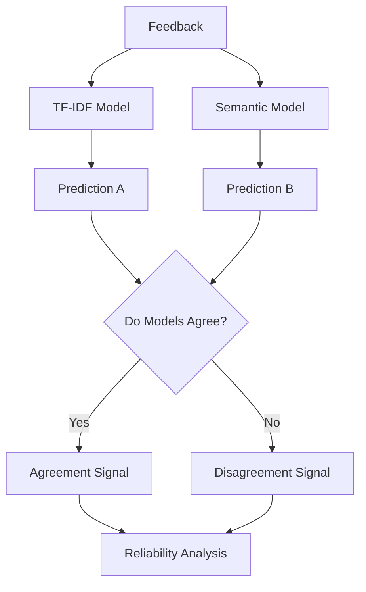
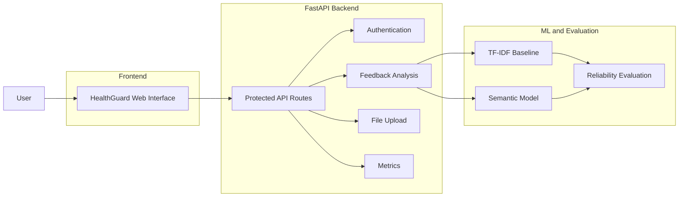
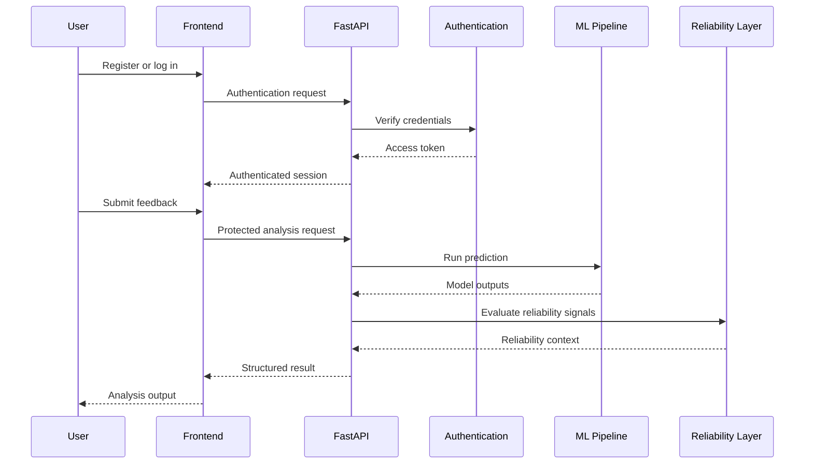

# HealthGuard system 

## Reliability-aware analysis of patient feedback

HealthGuard is an NLP and machine-learning application for converting unstructured patient-experience feedback into structured issue information.

The project goes beyond the usual pipeline of:

```text
Text → Model → Prediction
```

It also evaluates whether a prediction deserves to be trusted.

HealthGuard compares a classical TF-IDF model with a semantic embedding-based model and examines reliability signals including confidence, calibration, predictive uncertainty, out-of-distribution behavior, and disagreement between models.

The central engineering question behind the project is:

> **A model can produce a prediction. How should the system determine whether that prediction is reliable enough to trust?**

HealthGuard is designed as decision support for operational feedback analysis. It does not make autonomous clinical or hospital decisions.

---

# What problem does HealthGuard address?

Patient feedback is usually unstructured.

Examples may contain complaints about:

* Billing
* Communication
* Waiting time
* Appointments
* Other operational experiences

A simple sentiment label is often insufficient.

An operational workflow may need to know:

* What issue is being reported?
* Are multiple issues present?
* How severe is the case?
* What evidence in the text supports the result?
* How confident is the model?
* Does confidence correspond to actual correctness?
* Is the input different from the data the model was trained on?
* Do independent modeling approaches agree?
* Should the prediction be reviewed instead of acted upon automatically?

HealthGuard was built around these questions.

---

# System Architecture



The two model approaches are evaluated independently before their behavior is examined through the reliability layer.

The purpose is not to assume that the more complex model is automatically better.

---

# Core Capabilities

## Patient feedback classification

HealthGuard processes feedback and classifies reported issue categories using trained machine-learning models.

The original application foundation includes:

* Text preprocessing
* TF-IDF vectorization
* Logistic Regression classification
* Sentiment analysis
* Issue categorization
* Priority and severity logic
* Persisted model artifacts
* Reusable inference pipelines

The TF-IDF model remains preserved as the classical baseline.

---

## Two modeling approaches

HealthGuard evaluates two representations of the same classification problem.

### Classical baseline

```text
Feedback Text
      ↓
TF-IDF Representation
      ↓
Logistic Regression
      ↓
Issue Classification
```

This model provides a lightweight and interpretable baseline.

### Semantic model

```text
Feedback Text
      ↓
Semantic Embedding Representation
      ↓
Dense Feature Vector
      ↓
Logistic Regression
      ↓
Issue Classification
```

The semantic approach is evaluated separately to determine whether a semantic representation handles language variation differently from sparse TF-IDF features.

The goal is comparison rather than assuming improvement because the architecture is more complex.

---

# Evaluation Architecture

HealthGuard separates data used for model fitting from data used for evaluation decisions.



The challenge set remains separate from model fitting and validation decisions.

This allows difficult cases to be evaluated without treating them as ordinary in-distribution benchmark data.

---

# Data Quality and Leakage Prevention

A major part of the project involved examining whether the evaluation process itself could produce misleading results.

The evaluation workflow includes:

* Data contracts
* Train / validation / test separation
* Duplicate detection
* Leakage checks
* Challenge-set isolation
* Per-class metrics
* Confusion matrices
* Accuracy
* Precision
* Recall
* Macro F1
* Machine-readable evaluation output
* Dataset and model metadata

During dataset evaluation, the project identified a high duplicate-text rate in the original synthetic dataset.

This matters because a naive random split can place identical or near-identical examples in both training and evaluation data.

That can make benchmark performance appear stronger than the model's ability to generalize.

HealthGuard therefore treats dataset isolation and deduplicated evaluation as part of the ML system rather than only as preprocessing details.

---

# Challenge and Robustness Evaluation

HealthGuard includes a separate challenge set for diagnostic evaluation.

The challenge examples cover cases such as:

| Challenge type     | Purpose                                         |
| ------------------ | ----------------------------------------------- |
| Paraphrase         | Different wording for the same underlying issue |
| Ambiguous          | More than one plausible interpretation          |
| Multi-issue        | Multiple complaints in one feedback item        |
| Low-information    | Very limited context                            |
| Unfamiliar wording | Informal or unusual language                    |
| Out-of-domain      | Feedback unrelated to trained issue categories  |
| Edge cases         | Difficult classification boundaries             |

These cases are evaluated separately from normal held-out test performance.

---

# Reliability-Aware Predictions

A probability returned by `predict_proba()` is not automatically treated as a trustworthy prediction.

HealthGuard evaluates several signals around a prediction.



The objective is not simply to increase model accuracy.

The reliability layer asks:

> **Should this prediction be trusted under the current conditions?**

---

# Confidence Calibration

A model can be highly confident and still be wrong.

HealthGuard evaluates whether predicted confidence corresponds to observed correctness.

The evaluation includes diagnostics such as:

* Brier score
* Expected Calibration Error
* Reliability diagnostics
* Confidence distributions
* Accuracy by confidence bucket

Conceptually, the system distinguishes:

```text
High Confidence
      ↓
Is the prediction actually more likely to be correct?
      ↓
Calibration analysis
```

This is important because raw probability scores alone do not guarantee reliability.

---

# Uncertainty

Each prediction can be represented using information such as:

```json
{
  "prediction": "issue_category",
  "confidence": 0.0,
  "margin": 0.0,
  "entropy": 0.0,
  "uncertainty_level": "..."
}
```

The signals capture different aspects of model behavior.

For example, a model may have:

* A low maximum probability
* A small margin between competing classes
* High predictive entropy

These signals can indicate that the classification decision is ambiguous.

---

# Out-of-Distribution Analysis

HealthGuard includes an explainable experiment for detecting whether feedback differs substantially from the model's training distribution.

A key distinction in the project is:

```text
Classification Uncertainty
        ≠
Out-of-Distribution Detection
```

A low-confidence prediction is not automatically an out-of-distribution input.

Similarly, an input that differs substantially from the training distribution may require separate handling even if the classifier produces a confident output.

The two signals are evaluated independently.

---

# Model Disagreement

HealthGuard compares predictions produced by the classical and semantic models.



Model disagreement is not automatically treated as proof that a prediction is wrong.

Instead, the project evaluates whether disagreement is associated with a higher probability of prediction errors.

This turns model disagreement into an observable diagnostic signal rather than an assumption.

---

# Key Experimental Findings

HealthGuard intentionally preserves findings that do not support a simple "the newer model is better" narrative.

The evaluation identified several important patterns.

## Strong in-distribution performance does not guarantee robustness

The baseline performed strongly on normal held-out synthetic data.

Performance degraded more substantially on difficult challenge cases.

This demonstrates why a single benchmark accuracy value is not sufficient for evaluating model reliability.

---

## The semantic model was not automatically better

The semantic model evaluation showed:

* No clear overall accuracy improvement over the classical baseline
* Improvement on some unfamiliar wording
* Weakness on other difficult categories
* Higher confidence without consistently higher correctness

This produced an important engineering conclusion:

> **A more sophisticated representation is not automatically more reliable.**

---

## Different models can fail differently

The uncertainty experiments highlighted trade-offs between model behavior.

A highly conservative operating point can produce:

```text
Lower automation coverage
        +
Higher reliability among trusted predictions
```

while a more permissive operating point can produce:

```text
Higher automation coverage
        +
Greater risk on difficult cases
```

This is why HealthGuard evaluates reliability separately from raw classification accuracy.

---

# Application Architecture

HealthGuard also includes an application layer around the ML pipeline.



The application foundation includes:

* FastAPI backend
* JWT authentication
* Password hashing
* User registration and login
* Protected routes
* Feedback analysis APIs
* File upload support
* Metrics endpoints
* Workspace functionality

---

# Application Flow



---

# Technology Stack

| Layer             | Technology          | Usage                             |
| ----------------- | ------------------- | --------------------------------- |
| Backend           | Python + FastAPI    | Application API                   |
| Server            | Uvicorn             | ASGI server                       |
| Classical ML      | scikit-learn        | Model training and inference      |
| Text Features     | TF-IDF              | Sparse text representation        |
| Semantic Features | spaCy embeddings    | Dense semantic representation     |
| Classifier        | Logistic Regression | Issue classification              |
| NLP               | spaCy + NLTK        | Text processing                   |
| Authentication    | JWT                 | Protected application access      |
| Password Security | PBKDF2              | Password hashing                  |
| Data Processing   | Pandas + NumPy      | Dataset processing and evaluation |
| Model Persistence | Joblib              | Saved model artifacts             |

---

# Project Structure

```text
HealthGuard/
│
├── backend/
│   ├── api/
│   ├── auth.py
│   └── main.py
│
├── frontend/
│
├── data/
│   ├── splits/
│   │   ├── train.csv
│   │   ├── val.csv
│   │   └── test.csv
│   │
│   └── challenge_set.csv
│
├── evaluation/
│   ├── evaluate.py
│   ├── benchmark_model.py
│   ├── semantic_model.py
│   ├── embeddings.py
│   └── ...
│
├── models/
│   ├── issue_classifier/
│   ├── benchmark_issue_classifier/
│   ├── semantic_issue_classifier/
│   └── uncertainty/
│
├── modules/
│   ├── ml_issue_classifier.py
│   └── ...
│
├── training/
│
├── tests/
│
├── requirements.txt
│
└── README.md
```

---

# Running Locally

## 1. Clone the repository

```bash
git clone <repository-url>
cd HealthGuard
```

## 2. Create a virtual environment

### macOS / Linux

```bash
python3 -m venv .venv
source .venv/bin/activate
```

### Windows

```bash
python -m venv .venv
.venv\Scripts\activate
```

---

## 3. Install dependencies

```bash
pip install -r requirements.txt
```

---

## 4. Install NLP resources

```bash
python -c "
import nltk
nltk.download('punkt')
nltk.download('punkt_tab')
nltk.download('stopwords')
nltk.download('wordnet')
"
```

---

## 5. Configure the JWT secret

### macOS / Linux

```bash
export HEALTHGUARD_JWT_SECRET="your-long-random-secret"
```

### Windows PowerShell

```powershell
$env:HEALTHGUARD_JWT_SECRET="your-long-random-secret"
```

---

## 6. Run the application

```bash
uvicorn backend.main:app --host 0.0.0.0 --port 8000
```

Open:

```text
http://127.0.0.1:8000
```

---

# Running Tests

Run the complete test suite:

```bash
python -m unittest discover -s tests -v
```

The test suite covers areas including:

* Dataset isolation
* Leakage prevention
* Evaluation structure
* Benchmark isolation
* Semantic model training isolation
* Calibration workflow
* Threshold selection
* OOD detection
* Model disagreement
* Frozen artifact integrity
* Structured evaluation output

---

# Reproducibility

HealthGuard treats datasets and trained model artifacts as controlled evaluation assets.

The project tracks information such as:

* Dataset versions
* Random seeds
* Model identifiers
* Feature configuration
* Evaluation timestamps
* Artifact hashes
* Frozen model integrity

Frozen artifacts are separated from test-generated outputs to reduce the risk of evaluation models being silently overwritten during testing.

---

# Reliability and Safety Principles

## Synthetic performance is not presented as clinical performance

The evaluation data is synthetic.

High benchmark performance on this dataset is not presented as evidence that the system is ready for real-world hospital deployment.

---

## Predictions are not treated as root-cause conclusions

HealthGuard distinguishes between:

```text
Observed Feedback Evidence
        ≠
Confirmed Operational Root Cause
```

The system can identify patterns in feedback without claiming that it has independently established the underlying operational cause.

---

## Low-reliability cases should remain reviewable

The purpose of uncertainty and disagreement analysis is not to eliminate human review.

A reliability signal can indicate that a case deserves additional attention rather than automated action.

---

## The application is decision support

HealthGuard is designed to assist operational review.

It is not intended to make autonomous clinical, financial, or hospital-management decisions.

---

# Engineering Decisions

## The baseline is preserved instead of replaced

The TF-IDF model remains part of the evaluation system after introducing semantic embeddings.

This makes it possible to compare approaches directly rather than replacing the original model and losing the reference point.

---

## Validation and challenge data have different purposes

Validation data is used for decisions such as:

* Calibration
* Threshold selection
* Operating-point selection

The held-out test set is used for final in-distribution evaluation.

The challenge set is used for diagnostic robustness analysis.

```text
Training
   ↓
Model Fitting

Validation
   ↓
Calibration and Threshold Decisions

Test
   ↓
Final In-Distribution Evaluation

Challenge / OOD
   ↓
Robustness Diagnostics
```

These roles are intentionally separated.

---

## Reliability is treated as a measurable system property

The project does not assume that confidence is reliability.

Instead, it examines multiple signals:

```text
Prediction
    +
Confidence
    +
Calibration
    +
Uncertainty
    +
OOD Signal
    +
Model Agreement
    ↓
Reliability Assessment
```

---

# Current Scope

The ML evaluation and reliability research foundation is implemented.

The current repository includes the application foundation and the evaluation components described above.

The remaining product-oriented work focuses on integrating the reliability findings more deeply into the user-facing decision layer.

Areas for continued development include:

* Reliability-aware case views
* Evidence-backed issue summaries
* User-facing explanations of reliability signals
* High-priority issue identification
* Emerging issue trends
* Reliability-aware operational metrics
* Action-oriented recommendations with explicit evidence boundaries

These are presented as future integration work rather than completed functionality.

---

# Project Context

HealthGuard brings together several engineering areas that are often treated separately:

* NLP preprocessing
* Text classification
* Classical machine learning
* Semantic representations
* Dataset quality checks
* Leakage prevention
* Model benchmarking
* Calibration
* Predictive uncertainty
* Out-of-distribution analysis
* Model disagreement
* Authentication
* API development
* Application integration
* Reproducible evaluation

The project is built around a broader question than classification accuracy.

> **Can the system identify not only what it predicts, but also when the conditions around that prediction suggest caution?**

---

]
