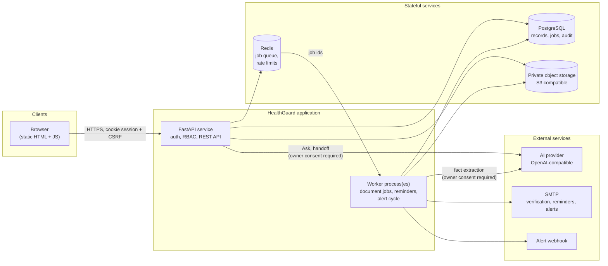
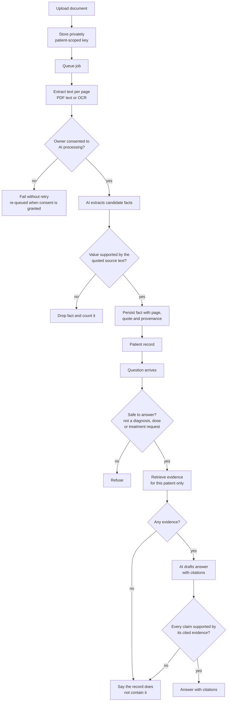
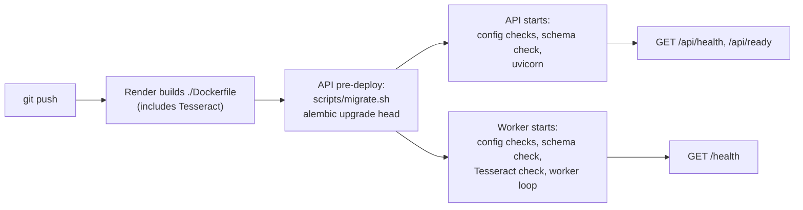

# HealthGuard

**A patient-owned health record you can ask questions of, where every AI answer has to prove itself against the record or be refused.**

HealthGuard turns the scattered paperwork of a person's health (lab reports, prescriptions, discharge summaries, clinic notes) into one
structured, evidence-linked record. A patient, a family member or a doctor can then ask plain-language questions such as *"What was my last
HbA1c?"* or *"When did I start metformin?"* and get an answer **only if it can be traced to a specific page of a specific document**. Anything
the record cannot support, and anything that amounts to a diagnosis, a prescription or a dose change, is declined.

> **Status: an engineering project, not a medical device.** It has not been clinically validated, has not been assessed against HIPAA, GDPR or
> any other regulation, and must not be used with real patient data. See [Honest status](#honest-status-and-limitations) and
> [`docs/RELEASE_AUDIT.md`](docs/RELEASE_AUDIT.md) for the exact open blockers.

---

## Contents

1. [Why it exists](#why-it-exists)
2. [What you can do with it](#what-you-can-do-with-it)
3. [How it works](#how-it-works)
4. [Design principles](#design-principles)
5. [Results at a glance](#results-at-a-glance)
6. [Technology](#technology)
7. [Run it](#run-it)
8. [Repository map](#repository-map)
9. [Documentation](#documentation)
10. [Honest status and limitations](#honest-status-and-limitations)

---

## Why it exists

A person's health history is fragmented across hospitals, labs and pharmacies, mostly as PDFs and photographs. Two failure modes follow:

- **Patients and families cannot answer simple questions** about their own history, and arrive at appointments without the context a doctor needs.
- **Generic AI assistants answer confidently and unverifiably.** In a medical setting a fluent but wrong answer ("your hemoglobin was 9.0" when the report says 14.2)
  is worse than no answer.

HealthGuard is built around the second problem. The interesting engineering is not the chat box; it is the machinery that decides **when the system is
allowed to speak**.

## What you can do with it

| Area | What it does |
|---|---|
| **Records** | Patient profiles; a dated timeline of consultations, diagnoses, medication changes, investigations, hospitalisations and vaccinations; medications with history; lab results and measurements with trend charts. |
| **Documents** | Upload PDFs and images. A background worker extracts text (OCR for scans), classifies the document, and extracts structured facts, each carrying its **source page and quoted text** and a provenance label. |
| **Ask My Records** | Plain-language questions answered from the patient's own evidence, with citations. Unsupported or unsafe answers are replaced by a refusal. |
| **Doctor-visit preparation** | Generates an evidence-backed handoff summary as an editable draft; finalising it makes it immutable. |
| **Follow-ups and reminders** | Track actions derived from documents or entered manually; opt-in email reminders with idempotent, retried delivery. |
| **Sharing** | Grant a family member, caregiver or doctor access limited to specific **scopes**, with expiry and instant revocation; or create a time-limited share link. |
| **Privacy controls** | Explicit, versioned consent for AI processing; one-click export of everything held about a patient (JSON or ZIP with original files); deletion that removes the file, the extracted text and the derived facts. |
| **Operations** | A separate admin console with no access to patient data: queue health, AI telemetry (latency, errors, tokens), security events and alerts delivered by webhook or email. |

## How it works

### System overview



### From document to answer



The second half of that diagram is the heart of the project: **the model never has the last word.** Its draft is checked claim by claim by deterministic
code (numbers, dates, units, negation, who the statement is about, whether a medicine is current or stopped) before anything reaches the user.
[`docs/ARCHITECTURE.md`](docs/ARCHITECTURE.md) explains each stage.

## Design principles

1. **Fail closed.** If validation cannot confirm an answer, the user sees a refusal, never a best guess. Rate limiting, consent and storage failures behave the same way in production.
2. **Evidence or silence.** Every extracted fact keeps its page, quote and provenance. A fact whose value its own quote does not support is dropped.
3. **Document content is data, never instructions.** Sentences inside an uploaded document that read like commands to an AI cannot support a claim.
4. **Isolation is structural.** Retrieval is scoped to one patient by construction, and deleted documents are excluded at every read path (and their derived content is purged).
5. **Measure before claiming.** Release gates were fixed *before* the first measurement, and the baseline that failed them is kept in the repository.
6. **State what is not verified.** The audit report lists unexecuted checks as plainly as passing ones.

## Results at a glance

Full methodology, datasets and caveats are in [`docs/EVALUATION.md`](docs/EVALUATION.md). These figures measure HealthGuard's *own checking layers* on small,
hand-written synthetic cases. They are **not** model accuracy and **not** clinical accuracy.

| Release gate | Before fixes | After fixes | Bar |
|---|---:|---:|---:|
| Unsupported claims rejected | 60% | **100%** | ≥ 95% |
| Dangerous contradictions accepted (negation, unit, subject, ...) | 9 | **0** | 0 |
| Valid claims wrongly rejected | 33% | **0%** | ≤ 10% |
| Diagnosis / dose requests refused | 77% | **100%** | ≥ 98% |
| Plain record look-ups wrongly refused | 18% | **0%** | ≤ 10% |
| Invented extracted facts rejected | 17% | **100%** | ≥ 95% |
| Cross-patient and deleted-document leakage | 0 | **0** | 0 |

Before the fixes **10 of 17 gates failed**; all 18 now pass, and the run is deterministic. On a separate held-out set (first and only clean run) the
safety classifier's refusal recall was **67%**, a genuine weakness that the report documents rather than hides.

The test suite stood at **616 passing tests (611 non-browser including real PostgreSQL, 5 real-browser), 0 skipped** at audit time. The deployment-hardening changes in this build added tests of their own (`tests/test_deployment_readiness.py`, `tests/p0/test_email_provider_consistency.py`, and an updated release test); those 60 tests (this file plus the updated release test) were re-run for this documentation pass and pass, but the full suite was not re-run, so the 616 figure is the audit-time number.

## Technology

| Layer | Choice |
|---|---|
| API | Python, FastAPI, Pydantic, SQLAlchemy 2, Alembic |
| Data | PostgreSQL (SQLite for tests), Redis, S3-compatible object storage |
| Background work | A dedicated worker with leases, retries with backoff, stale-job recovery and quarantine |
| AI | Any OpenAI-compatible chat endpoint behind a strict schema; deterministic validators around it |
| Frontend | Static HTML, CSS and vanilla JavaScript (no build step) |
| Quality | pytest, Playwright with real Chromium, axe-core accessibility scan, a purpose-built AI evaluation suite |
| Delivery | One non-root Docker image (bundles Tesseract) used by both Render services; docker-compose stack (PostgreSQL, Redis, MinIO, Mailpit dev mailbox); fail-fast production config checks; GitHub Actions workflow |

The repository also contains the earlier **patient-feedback analytics** app (Streamlit plus classical ML); it is documented in the phase reports listed below.

## Run it

Local development (SQLite, local file storage, no external services):

```bash
cp .env.example .env                       # set HEALTHGUARD_JWT_SECRET to a long random value
pip install -r requirements.txt -r requirements-dev.txt
alembic upgrade head
uvicorn backend.main:app --reload          # http://127.0.0.1:8000/login
python -m jobs.worker                      # in a second terminal: processes uploaded documents
```

Production-like stack (PostgreSQL, Redis, MinIO, API and worker):

```bash
docker compose up --build
```

Tests and evaluation:

```bash
python -m pytest -rs                                  # a skipped test counts as a failure
python -m evaluation.healthguard.runner               # AI release gates; exit code 1 if any gate fails
HEALTHGUARD_CHROMIUM_PATH=/path/to/chromium python -m pytest tests/p0/test_browser_privacy_a11y.py
python scripts/make_release.py                        # clean, deterministic release package
```

### Deploying

The production path is two Docker services on Render (`healthguard-api`, `healthguard-worker`) built from the same image, plus managed PostgreSQL, Redis and an S3-compatible bucket that you provision yourself. Both services refuse to start on a bad configuration instead of failing later in front of a user.



Step by step, with the full variable matrix and the smoke-test checklist, in [`docs/DEPLOYMENT.md`](docs/DEPLOYMENT.md).

AI features stay disabled until `HEALTHGUARD_LLM_API_KEY` (and the related `HEALTHGUARD_LLM_*` settings in `.env.example`) are configured. Once a key is
set, each record owner must grant AI consent in **Settings, Privacy and data** before any text is sent to the provider. Use synthetic documents only.

## Repository map

```
backend/      FastAPI app, auth, security middleware, request-size limiter
api/          Route modules: patient records, privacy and export, admin, reminders, schemas
domain/       Business logic: retrieval, grounding validation, AI safety, consent, export,
              retention, alert delivery, rate limiting, observability, clinical term lexicon
ai/           Provider adapters (strict schema, telemetry) for answers and document analysis
jobs/         Queue, worker loop, leases and recovery, worker health
db/           SQLAlchemy models and session handling;  alembic/ holds migrations (head 0018)
storage/      Local and S3 object storage with patient-scoped keys
frontend/     Static pages and scripts;  frontend/css design tokens
evaluation/   healthguard/ (AI release-gate suite, datasets, reports); earlier ML evaluation code
tests/        Unit, integration, real-PostgreSQL, real-browser and accessibility tests
utils/        production_config.py: startup checks shared by the API and the worker
deploy/       Production runbook;  scripts/ start, worker, migrate, schema-check, admin and release scripts
docs/         Architecture, sprint history, evaluation, release audit
```

## Documentation

| Document | What it covers |
|---|---|
| [`docs/ARCHITECTURE.md`](docs/ARCHITECTURE.md) | Components, data model, request and document flows, the grounding pipeline, security, failure behaviour and design decisions |
| [`docs/DEPLOYMENT.md`](docs/DEPLOYMENT.md) | How the system runs on Render and in Docker Compose: topology, boot sequence, the startup checks and what each one catches, configuration matrix, smoke tests, known gaps in the blueprint |
| [`docs/OPERATIONS.md`](docs/OPERATIONS.md) | Running it: health and metrics endpoints, what the worker loops do, reminder and alert delivery state machines, admin access, incident decision tree, backup and recovery |
| [`docs/API.md`](docs/API.md) | Every registered route, grouped by area, with who may call it; authentication and CSRF flow |
| [`docs/EVALUATION.md`](docs/EVALUATION.md) | The AI evaluation suite, release gates, before and after results, held-out generalisation and limits |
| [`docs/RELEASE_AUDIT.md`](docs/RELEASE_AUDIT.md) | The authoritative readiness verdict, defects found and fixed, and the exact open blockers |
| [`docs/SPRINTS.md`](docs/SPRINTS.md) | How the system was built, sprint by sprint, with what each stage delivered and what it found |
| [`deploy/PRODUCTION.md`](deploy/PRODUCTION.md) | The terse production checklist that `docs/DEPLOYMENT.md` expands on |
| [`docs/archive/README_sprint1_api_reference.md`](docs/archive/README_sprint1_api_reference.md) | The original Sprint 1 README (superseded; `docs/API.md` is the current route reference) |
| `PHASE1_ML_UPGRADE.md` ... `PHASE3C_*.md` | The earlier patient-feedback ML work (classifier, semantic model, calibration, out-of-distribution handling) |

## Honest status and limitations

**Not launch-ready.** The blockers, with evidence, are in [`docs/RELEASE_AUDIT.md`](docs/RELEASE_AUDIT.md). In short:

- The pinned dependencies carry **199 known vulnerabilities**; a clean upgrade set exists but was not adopted because it failed an existing test.
- The Python 3.11 / Docker build, real S3, a real AI provider, load and capacity, and backup/restore were **never verified** in the environment this was built in.
- AI accuracy on real documents has **not been measured**. Every evaluation case is synthetic and written by the validators' author, so results probably flatter the system.
- The input safety classifier is pattern-based and one layer of several; its held-out recall was 67% on first contact.
- Accessibility: serious axe-core violations are fixed, moderate ones remain, and no screen-reader testing was done.

This software gives no medical advice and must not be used to make clinical decisions.
