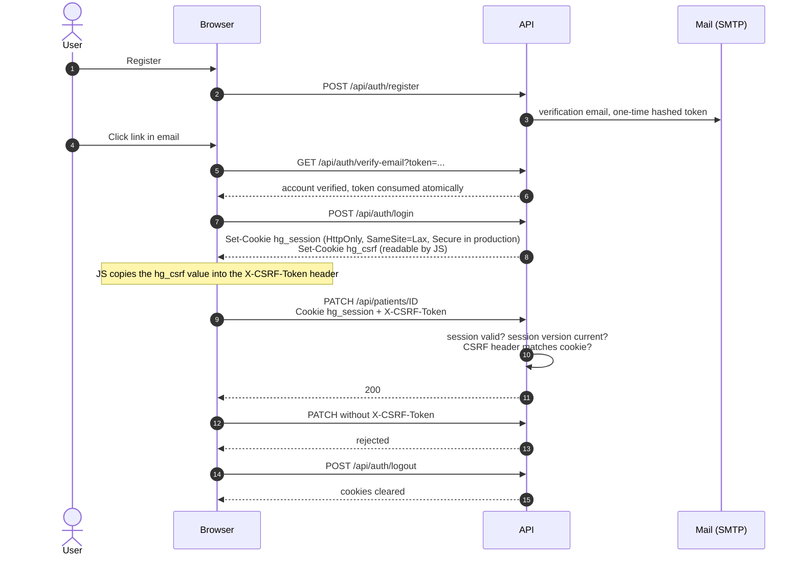
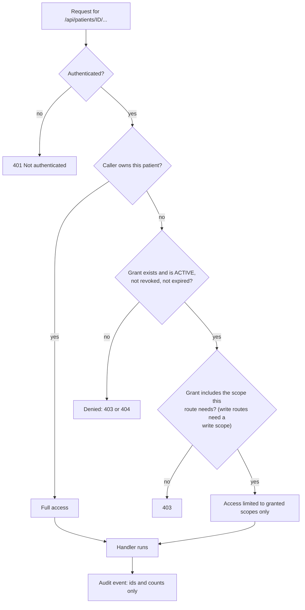

# HealthGuard API reference

Every route the application registers, grouped by what it is for, with who may call it. The route list was generated from the running FastAPI app
(`app.routes`) rather than written by hand, so it matches the code; the one-line purposes are descriptive, not a schema. The authoritative request and response
schemas are in the live OpenAPI document at `/openapi.json` (interactive at `/docs`), and in `api/schemas.py`.

127 method-and-path combinations are registered: 105 under `/api` and 22 that serve static pages or FastAPI's own documentation (`/docs`, `/redoc`, `/openapi.json`, `/docs/oauth2-redirect`).

## Contents

1. [Authentication, sessions and CSRF](#authentication-sessions-and-csrf)
2. [How a patient route authorizes a request](#how-a-patient-route-authorizes-a-request)
3. [Rate limits](#rate-limits)
4. [Route tables](#route-tables)
5. [Legacy analytics routes](#legacy-analytics-routes)
6. [Pages](#pages)

---

## Authentication, sessions and CSRF

Two kinds of client are supported. Browsers use an **HttpOnly session cookie** with CSRF protection. Scripts and tools use a **bearer token**. The server
accepts either; a bearer token is exempt from the CSRF check because it is not sent automatically by a browser.

- Accounts must verify their email before they can log in. `POST /api/auth/resend-verification` is rate limited to 3 per minute.
- Tokens carry only the user id, a **session version** and an expiry (default 8 hours, `HEALTHGUARD_TOKEN_EXPIRY_HOURS`). `exp` and `sub` are required claims.
  Bumping the user's session version, which `POST /api/admin/users/{user_id}/revoke-sessions` does, invalidates every token at once.
- Passwords are salted PBKDF2-HMAC-SHA256 (`HEALTHGUARD_PBKDF2_ITERATIONS`, default 600,000).
- Allowed CORS headers: `Authorization`, `Content-Type`, `Accept`, `X-CSRF-Token`. Allowed methods: `GET`, `POST`, `PATCH`, `DELETE`, `OPTIONS`. Note that **`PUT`
  is registered on two routes** (`reminder-preferences` and `privacy/consents/{purpose}`) but is not in the CORS allow-list. Same-origin browser use is
  unaffected because the frontend is served by the same application; a cross-origin browser client would be blocked from those two.

## How a patient route authorizes a request

All patient-scoped routes resolve access through one function, so there is a single place to reason about isolation. The question it answers is always the same:
*is this caller the owner, or do they hold a current grant with the right scope?*

Scopes: `PROFILE`, `DOCUMENTS`, `MEDICATIONS`, `INVESTIGATIONS`, `TIMELINE`, `HANDOFFS`, `HEALTH_ACTIONS`, `MEASUREMENTS`. Grants are re-evaluated on **every
request** against their current status and expiry, so revocation takes effect immediately. Owner-only routes (export, consent decisions, granting and revoking
access, deleting the patient) are marked below.

## Rate limits

A route with a limit counts requests per **route bucket, client address and authenticated identity** in a 60-second window. Without `REDIS_URL` it falls
back to per-process counters outside production; in production an unavailable limiter returns `503` rather than allowing unlimited traffic. The default for
other limited routes is `HEALTHGUARD_RATE_LIMIT_PER_MINUTE` (60).

| Bucket | Per minute | Route |
|---|---:|---|
| `register`, `login` | 10 | `POST /api/auth/register`, `POST /api/auth/login` |
| `verification_resend` | 3 | `POST /api/auth/resend-verification` |
| `patient_export` | 5 | `GET /api/patients/{id}/export` |
| `handoff_generation` | 10 | `POST /api/patients/{id}/handoffs` |
| `share_create` | 10 | `POST /api/patients/{id}/shares` |
| `share_access` | 30 | `POST /api/shares/access` |
| `document_upload` | 30 | `POST /api/patients/{id}/documents` |
| `document_processing` | 20 | `POST /api/documents/{id}/retry-processing` |
| `medication_context` | 20 | `POST /api/patients/{id}/medications/{mid}/context` |
| `record_retrieve` | 30 | `POST /api/patients/{id}/retrieve` |
| `record_ask` | 20 | `POST /api/patients/{id}/ask` |
| `measurement_write` | 120 | `POST /api/patients/{id}/measurements` |
| `reminder_prefs` | 30 | `PUT /api/patients/{id}/reminder-preferences` |
| `upload` | 30 | `POST /api/upload` (legacy) |
| `admin_session` | 5 | `POST /api/admin/session` |
| `admin_job_action` | 30 | admin job retry, quarantine |
| `admin_user_action` | 20 | admin revoke-sessions |
| `admin_alert_eval` | 20 | admin alert evaluate |

Request bodies are capped by `HEALTHGUARD_MAX_REQUEST_BODY_BYTES` (22 MiB default) counted on the bytes actually received, and a single document by
`HEALTHGUARD_MAX_DOCUMENT_BYTES` (20 MiB). Collection endpoints take `page` (minimum 1) and `page_size` (1 to 100).

## Route tables

**Access column.** *Public*: no credentials. *Session*: any logged-in user, further restricted to resources that user may see. *Patient*: session plus the
[patient authorization](#how-a-patient-route-authorizes-a-request) above. *Owner*: only the patient's owner. *Admin VIEWER / OPERATOR*: see
[`OPERATIONS.md`](OPERATIONS.md#admin-console-access). *Token*: `X-Metrics-Token`.

### Service health

| Method and path | Access | Purpose |
|---|---|---|
| `GET /api/health` | Public | Liveness only |
| `GET /api/ready` | Public | Bounded database, Redis and storage checks; `503` in production if any fail |
| `GET /api/ops/metrics` | Token | Prometheus exposition for the API process |

### Accounts and sessions

| Method and path | Access | Purpose |
|---|---|---|
| `POST /api/auth/register` | Public | Create an account; sends a verification email |
| `GET /api/auth/verify-email` | Public (token) | Consume a one-time verification token |
| `POST /api/auth/resend-verification` | Public | Issue a new verification email |
| `POST /api/auth/login` | Public | Log in; sets the session and CSRF cookies |
| `POST /api/auth/logout` | Session | Clear the cookies |
| `GET /api/auth/me` | Session | Current account |
| `POST /api/account/deactivate` | Session | Deactivate the account |
| `DELETE /api/account` | Session | Delete the account |

### Patient profiles and access

| Method and path | Access | Purpose |
|---|---|---|
| `GET`, `POST /api/patients` | Session | List patients you own or may see; create a profile |
| `GET`, `PATCH`, `DELETE /api/patients/{patient_id}` | Patient (`DELETE`: Owner) | Read, update, delete a profile |
| `GET`, `POST /api/patients/{patient_id}/access` | Owner | List or create access grants (role and scopes) |
| `DELETE /api/patients/{patient_id}/access/{user_id}` | Owner | Revoke a grant |
| `GET`, `POST /api/patients/{patient_id}/family` | Owner | Family and caregiver sharing |
| `DELETE /api/patients/{patient_id}/family/{user_id}` | Owner | Remove a family grant |
| `GET /api/family/overview` | Session | For each patient you own: who currently holds access, and how many share links are active |
| `GET`, `POST /api/patients/{patient_id}/shares` | Owner | List or create time-limited share links |
| `POST /api/shares/access` | Public (link secret) | Redeem a share link; the secret is stored only as a hash |
| `POST /api/shares/{share_id}/revoke` | Owner | Revoke a share link |

### Health record

| Method and path | Access | Purpose |
|---|---|---|
| `GET`, `POST /api/patients/{patient_id}/events` | Patient | Timeline events: consultations, diagnoses, hospitalisations, vaccinations |
| `PATCH`, `DELETE /api/events/{event_id}` | Patient | Edit or remove an event |
| `GET`, `POST /api/patients/{patient_id}/medications` | Patient | Medications |
| `GET`, `POST /api/medications/{medication_id}/events` | Patient | Medication history: started, changed, stopped |
| `POST /api/patients/{patient_id}/medications/{medication_id}/context` | Patient | Medication context lookup (rate limited) |
| `GET /api/patients/{patient_id}/medication-tracker` | Patient | Medication overview |
| `GET`, `POST /api/patients/{patient_id}/investigations` | Patient | Investigations |
| `GET`, `POST /api/investigations/{investigation_id}/results` | Patient | Results within an investigation |
| `GET`, `POST /api/patients/{patient_id}/measurements` | Patient | Measurements such as blood pressure or glucose |
| `GET /api/patients/{patient_id}/measurements/series` | Patient | A measurement as a time series for charts |
| `PATCH`, `DELETE /api/measurements/{measurement_id}` | Patient | Edit or remove a measurement |
| `GET /api/measurement-types` | Session | Catalogue of measurement types |
| `GET /api/patients/{patient_id}/health-facts` | Patient | Facts extracted from documents, each with page, quote and provenance |
| `GET /api/patients/{patient_id}/timeline`, `.../unified-timeline` | Patient | Chronological views of the record |
| `GET /api/patients/{patient_id}/summary`, `.../health-snapshot`, `.../dashboard`, `.../health-graph` | Patient | Summary and visual views of the record |

Every read above is filtered to the scopes the caller holds.

### Documents

| Method and path | Access | Purpose |
|---|---|---|
| `GET`, `POST /api/patients/{patient_id}/documents` | Patient | List; upload (streamed, size-checked, stored privately, job queued) |
| `GET`, `DELETE /api/documents/{document_id}` | Patient | Metadata; two-phase delete that purges file, text and facts |
| `GET /api/documents/{document_id}/content` | Patient | The original file, via the API (never a public URL) |
| `POST /api/documents/{document_id}/retry-processing` | Patient | Re-queue a failed document |
| `GET /api/processing-jobs/{job_id}` | Patient | Job status |

### Ask My Records and visit preparation

| Method and path | Access | Purpose |
|---|---|---|
| `POST /api/patients/{patient_id}/ask` | Patient + owner's AI consent | Grounded question answering; refuses unsafe or unsupported questions |
| `POST /api/patients/{patient_id}/retrieve` | Patient | Evidence retrieval without answer generation |
| `GET /api/patients/{patient_id}/doctor-questions` | Patient | Suggested questions for a visit |
| `GET`, `POST /api/patients/{patient_id}/handoffs` | Patient + owner's AI consent (`POST`) | List; generate a doctor-visit handoff draft |
| `GET`, `PATCH /api/handoffs/{handoff_id}` | Patient | Read; edit while a draft |
| `POST /api/handoffs/{handoff_id}/finalize` | Patient | Finalise; a finalised handoff is immutable |

### Follow-ups and reminders

| Method and path | Access | Purpose |
|---|---|---|
| `GET`, `POST /api/patients/{patient_id}/health-actions` | Patient | Follow-up actions |
| `POST /api/patients/{patient_id}/health-actions/suggest-from-evidence` | Patient | Suggest actions from document evidence (unconfirmed until the user confirms) |
| `GET`, `PATCH /api/health-actions/{action_id}` | Patient | Read, edit |
| `POST /api/health-actions/{action_id}/confirm`, `/complete`, `/cancel` | Patient | Confirm a suggestion; mark done; cancel |
| `GET`, `PUT /api/patients/{patient_id}/reminder-preferences` | Patient | Opt in, lead times, time of day, time zone, whether titles may appear |
| `GET /api/patients/{patient_id}/reminder-deliveries` | Patient | Delivery history |

### Privacy

| Method and path | Access | Purpose |
|---|---|---|
| `GET /api/privacy/consents` | Session | Current consent state and the wording version |
| `PUT /api/privacy/consents/{purpose}` | Session | Grant or withdraw; granting re-queues jobs that were waiting for consent |
| `GET /api/patients/{patient_id}/export` | Owner | JSON bundle, or ZIP with original files |

### Admin console

All admin routes are invisible (`404`) until `HEALTHGUARD_ADMIN_TOTP_KEY` is set; then they require an active admin grant and a TOTP step-up session.

| Method and path | Access | Purpose |
|---|---|---|
| `GET /api/admin/probe`, `GET /api/admin/me` | Session / Admin | Is the console available; who am I |
| `POST`, `DELETE /api/admin/session` | Admin | Start or end the TOTP step-up session |
| `GET /api/admin/overview`, `/deployment`, `/ai`, `/security`, `/users` | Admin VIEWER | Operational views; masked account metadata |
| `GET /api/admin/jobs` | Admin VIEWER | Processing jobs and their states |
| `POST /api/admin/jobs/{job_id}/retry`, `/quarantine`, `/release` | Admin OPERATOR | Audited job actions |
| `GET /api/admin/alerts` | Admin VIEWER | Alerts and delivery state |
| `POST /api/admin/alerts/evaluate`, `/{alert_id}/acknowledge`, `/{alert_id}/resolve` | Admin OPERATOR | Evaluate now; acknowledge; resolve |
| `POST /api/admin/users/{user_id}/revoke-sessions` | Admin OPERATOR | Invalidate every session for a user |

No admin route returns patient data.

## Legacy analytics routes

These belong to the original patient-feedback analytics workspace, which is kept for compatibility and is intentionally not linked from the HealthGuard
landing, login or primary navigation. They require a session.

| Method and path | Purpose |
|---|---|
| `POST /api/analyze` | Classify one piece of feedback text |
| `POST /api/upload`, `GET /api/uploads` | Upload a survey file; list your uploads |
| `GET /api/metrics` | Model metrics for the analytics workspace |

## Pages

Static pages served by the same application (no build step): `/` (landing), `/login`, `/register`, `/verify`, `/hub`, `/workspace`, `/patient`, `/health`,
`/actions`, `/handoff`, `/settings`, `/admin`, plus the legacy `/analyze`, `/insights`, `/departments`, `/models`, `/dashboard.html` and `/analyze.html`.
`/docs`, `/redoc` and `/openapi.json` are FastAPI's own; see [`DEPLOYMENT.md`](DEPLOYMENT.md#known-gaps-in-the-blueprint) about exposing them in production.
