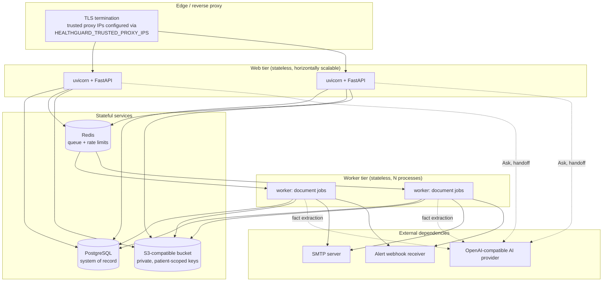
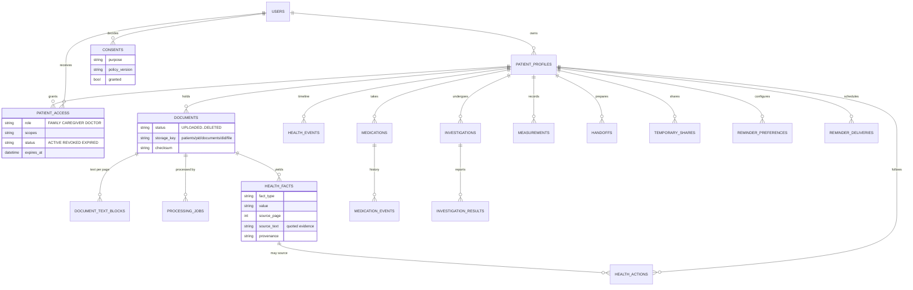
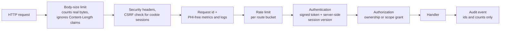
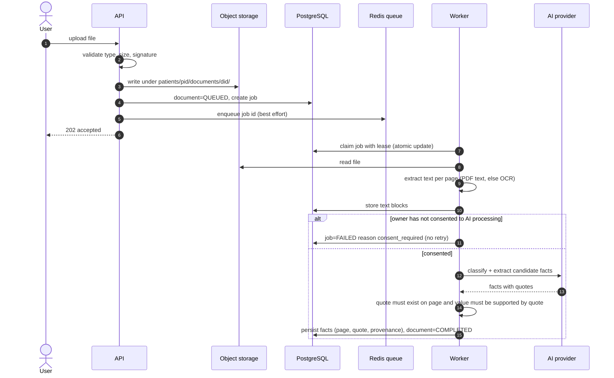
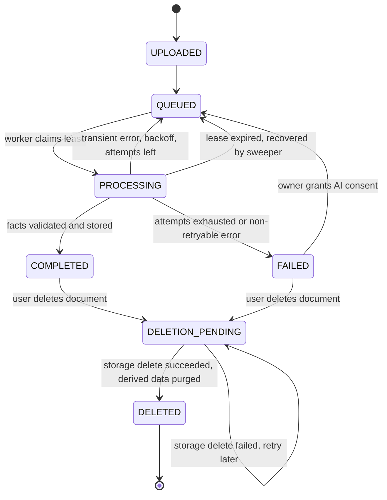
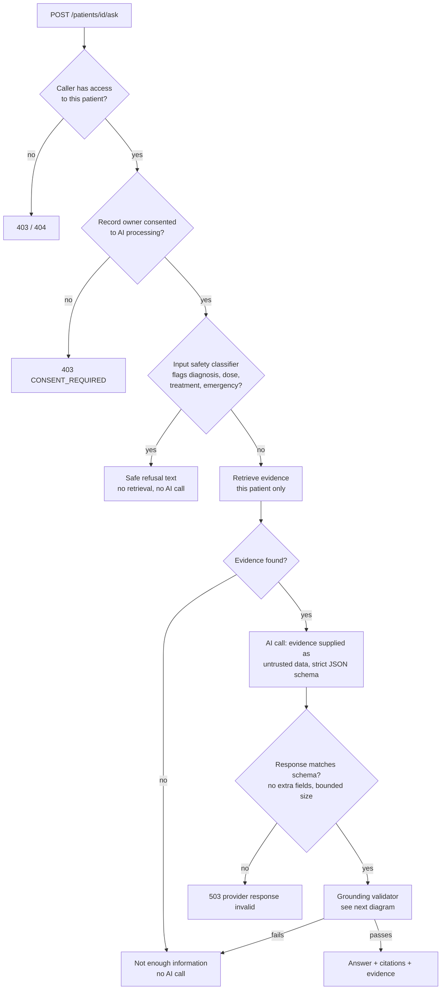
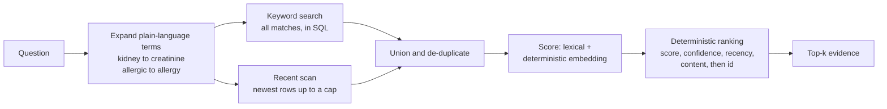
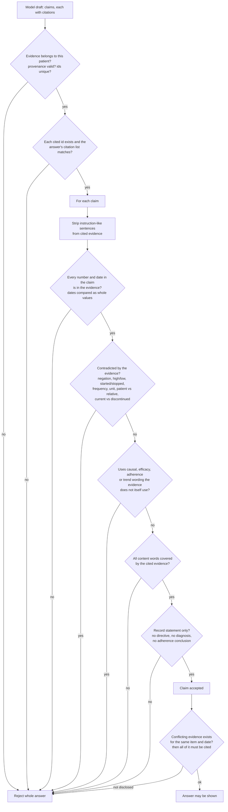
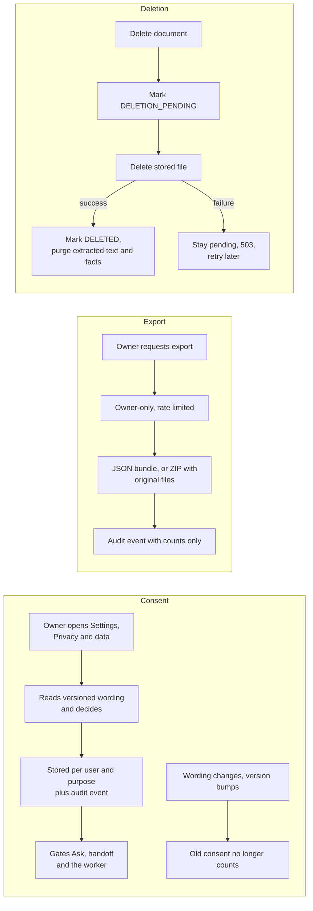
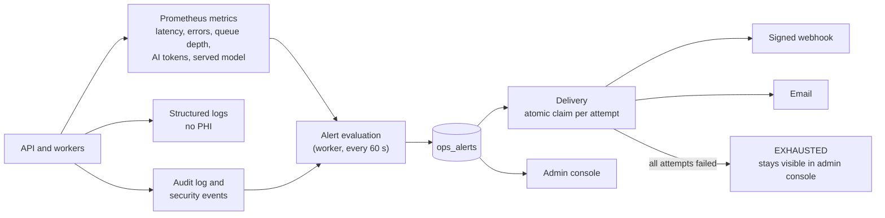

# HealthGuard architecture

This document explains how HealthGuard is built and, more importantly, *why* it is built that way. It describes what is in the code at head
migration `0018`. Where a behaviour has been exercised against real infrastructure it says so; where it has only been tested in-process, or not at
all, it says that too (see [Failure behaviour](#failure-behaviour)).

## Contents

1. [Goals and constraints](#goals-and-constraints)
2. [Components and deployment](#components-and-deployment)
3. [Data model](#data-model)
4. [Request pipeline and security layers](#request-pipeline-and-security-layers)
5. [Authorization model](#authorization-model)
6. [Document processing pipeline](#document-processing-pipeline)
7. [Ask My Records: retrieval, answering, validation](#ask-my-records-retrieval-answering-validation)
8. [Privacy lifecycle: consent, export, deletion](#privacy-lifecycle-consent-export-deletion)
9. [Operations: observability and alerting](#operations-observability-and-alerting)
10. [Failure behaviour](#failure-behaviour)
11. [Design decisions and trade-offs](#design-decisions-and-trade-offs)
12. [Known limitations](#known-limitations)

---

## Goals and constraints

| Goal | Consequence in the design |
|---|---|
| An AI answer must be **traceable to the record** | Facts keep page, quote and provenance; answers cite evidence ids; a deterministic validator checks every claim |
| The system must **never practise medicine** | A safety layer on the question, and an independent check on the output, block diagnosis, prescribing and dose changes |
| **One patient's data must never reach another** | Retrieval takes a patient id as a mandatory argument; every route resolves access through one authorization function |
| Users must be able to **leave and delete** | Owner-only export; deletion that removes the file, the extracted text and the derived facts |
| The system must **degrade safely** | Production fails closed (503 or refusal) instead of guessing; background work is idempotent and recoverable |
| It must be **operable** | PHI-free metrics and logs, a separate admin surface with no patient access, and alerts that are delivered, not just displayed |

Deliberate non-goals: clinical decision support, real-time chat, diagnosing from images, and any claim of regulatory compliance.

## Components and deployment

This section is the logical picture. How it is actually packaged and started on Render and in Docker Compose, including the startup checks that stop a
misconfigured process from running, is in [`DEPLOYMENT.md`](DEPLOYMENT.md); day-to-day running is in [`OPERATIONS.md`](OPERATIONS.md).

**What is shared and what is not.** The web and worker processes hold no session or job state in memory: sessions are signed tokens with a server-side
version counter, jobs live in PostgreSQL with Redis as a wake-up channel, and rate-limit counters live in Redis. That is what makes adding processes
safe. The single piece of per-process state is a local rate-limit fallback used only outside production.

**Two things the worker owns that are easy to miss.** Besides document jobs, the worker process sends all reminder and alert email and evaluates alerts every
60 seconds, so the system has no alerting and no reminders without at least one running worker. Both the API and the worker use the same mail sender
(`domain/mailer.py`); see [`DEPLOYMENT.md`](DEPLOYMENT.md#email-one-sender-three-callers).

**Roles of each store**

| Store | Holds | If it is unavailable |
|---|---|---|
| PostgreSQL | All records, jobs, consents, audit log, alerts | The service is down: readiness fails |
| Redis | Queue wake-ups, distributed rate-limit counters | Production rate limiting returns 503 (fail closed); the worker recovers queued jobs from PostgreSQL |
| Object storage | Original uploaded files | Uploads and exports of originals fail with a clear error; records remain available |

## Data model

The schema has 24 tables. Patient data hangs off `patient_profiles`; operational tables deliberately have no patient foreign key.

Operational tables with no patient link: `audit_logs`, `security_events`, `ops_alerts`, `admin_grants`, `email_verification_tokens`.

**Provenance is first-class.** Every health record carries one of `USER_REPORTED`, `FAMILY_REPORTED`, `DOCUMENT_VERIFIED` or `SYSTEM_DERIVED`, and the
client cannot choose it. Note that `DOCUMENT_VERIFIED` means "extracted from an uploaded document and its quote was found on the page"; it does **not**
mean a clinician verified it.

## Request pipeline and security layers

| Layer | Behaviour |
|---|---|
| Body limit | Enforced on the bytes actually received, so a chunked upload cannot bypass it (a real finding, now covered by a test against a live server) |
| CSRF | Cookie sessions require a matching CSRF header on mutating requests; bearer-token clients are exempt |
| Passwords | Salted PBKDF2-HMAC-SHA256; accounts require email verification |
| Tokens | Contain only user id, session version and expiry; `exp` and `sub` are required claims; bumping the version revokes all sessions |
| Rate limiting | Redis counters, one pooled client with 0.5 s connect and read timeouts, run off the event loop; in production an unavailable limiter returns 503 rather than allowing unlimited traffic |
| Audit | Records who did what to which resource, with counts and ids. It never stores question text, document text or answers |
| Admin surface | Separate router and authorization; a test asserts it exposes no patient routes and imports no patient models |

## Authorization model

All patient routes resolve access through one function, so there is a single place to reason about isolation.

| Principal | Can do | Cannot do |
|---|---|---|
| **Owner** | Everything on their patients, including export, consent decisions, granting and revoking access | n/a |
| **Family / Caregiver / Doctor (grantee)** | Only the **scopes** granted: `PROFILE`, `DOCUMENTS`, `MEDICATIONS`, `INVESTIGATIONS`, `TIMELINE`, `HANDOFFS`, `HEALTH_ACTIONS`, `MEASUREMENTS`; write access is a separate, narrower list | Export a copy, grant access onward, escalate to owner, use a grant after it is revoked or expired |
| **Temporary share link** | Time-limited read of what the owner chose; the link secret is stored only as a hash | Anything outside its scope or after expiry |
| **Administrator** | Operational views: queue health, AI telemetry, alerts, security events | See any patient data |

Two decisions worth noting:

- **Consent belongs to the record owner.** If a doctor with access asks a question, the owner's AI consent is what is checked, because the data being sent to the AI is the patient's.
- **Revocation is immediate.** Access is evaluated per request against the grant's current status and expiry, not cached in a token.

## Document processing pipeline

**Job state machine**

Key properties:

- **Claiming is atomic and leased**, so two workers never process the same job; a crashed worker's lease expires and the job is recovered, up to a bounded number of attempts.
- **Extraction is validated twice.** The quoted text must exist on the cited page (a failure fails the document), and the fact's *value* must be supported by that quote (a failure drops just that fact and increments a metric). The second check closes a gap where a model could attach an invented value to a real sentence.
- **A missing consent is not retried**, because waiting cannot create it. Granting consent re-queues exactly those jobs.

## Ask My Records: retrieval, answering, validation

### End to end

Note the two exits that **never call the AI**: refusals and empty evidence. They are cheap, deterministic and cannot be talked around.

### Retrieval

Seven sources are searched, always filtered to one patient and to **live** documents: facts, document text, events, medications, medication events,
investigations and results. Facts and text from `DELETED` or `DELETION_PENDING` documents are excluded; user-entered entries that cited such a document are
kept but lose the citation.

Why this shape: an earlier version considered only an arbitrary window of roughly 125 rows per source, so on large histories even an exact keyword
found nothing (measured: 3 of 3 keywords found at 100 facts, 0 of 3 at 1,000 and 5,000). Keyword matches are now always fetched in SQL, and the scan only
supplies the semantic "rescue" candidates. Ties used to be broken by random UUIDs; ranking is now reproducible.

### The grounding validator

This is the component that decides whether the model's draft may be shown. It is deterministic code, with no model in the loop.

Design notes:

- **Numbers and dates are compared as atomic values**, not as stray digits. "2024-03-01" cannot be satisfied by a "2024", a "3" and a "1" appearing elsewhere.
- **A dated series is history, not a contradiction.** HbA1c values from 2023 and 2024 can coexist; two different values for the same date must both be disclosed.
- **Multi-source claims are checked per number.** A value must sit in an evidence item that is about the same thing as the claim, which blocks "Hemoglobin 1.1" assembled from a hemoglobin result and a creatinine result.
- **The vocabulary is explicit.** Abbreviations, synonyms, opposites and frequency terms live in one reviewable file, `domain/clinical_terms.py`. It is small by design; terms it does not list are matched literally (see [limitations](#known-limitations)).

### Why a deterministic validator and not an AI judge

A second model grading the first would add cost and latency, and would itself be probabilistic and injectable. The failure we most need to prevent (a
fabricated lab value) is exactly the kind a rule can catch reliably. The trade-off is conservatism: legitimate paraphrases outside the lexicon are
rejected, and the evaluation measures that cost.

## Privacy lifecycle: consent, export, deletion

- **Consent** applies only when an external AI provider is configured, since otherwise nothing leaves the system. It is versioned, per user, and audited.
- **Export completeness is enforced by a test.** Every table must be listed either as exported or as deliberately excluded with a reason, so adding a table forces a decision.
  Secrets (password hashes, share-token hashes, storage keys) are never exported, grantee emails are masked, and deleted documents are excluded.
- **Deletion is two-phase on purpose.** The file is removed first; only on success are the extracted text and facts purged. A migration scrubs residue left by deletions made before this behaviour existed.

## Operations: observability and alerting

- **Alerts are evaluated automatically.** Previously they were evaluated only when an admin pressed a button, so nobody would have been told about a problem.
- **Delivery is at-most-once per attempt.** Each attempt is claimed with one atomic update, so concurrent workers cannot double-send (tested with four concurrent senders). Failures back off exponentially; after the configured attempts the alert becomes `EXHAUSTED`, which remains visible. An unacknowledged critical alert is repeated every few hours.
- **Payloads carry alert text only** (counts and component names). Webhooks are HMAC-signed and redirects are never followed.
- **AI telemetry** records latency, outcomes, the model requested and the model actually served (providers can silently change a model behind an alias), and token counts taken from the provider's own response. Cost appears only if the operator configures prices; it is never estimated.

## Failure behaviour

| Dependency or event | Behaviour | How it was verified |
|---|---|---|
| Redis hangs (accepts connections, never answers) | Bounded 0.5 s timeouts, work off the event loop. Health stays at ~50 ms; production returns 503 for the limited request | **Real server drill** against a black-hole socket, plus tests with a real `redis-server` |
| Redis unavailable in production | Rate limiter fails closed (503) | Unit test |
| Oversized chunked upload | 413 before it is buffered | **Real server** and in-process test |
| Storage delete fails | Document stays `DELETION_PENDING`, 503, retryable; derived data not yet purged | Unit test |
| Worker crashes mid-job | Lease expires and the job is recovered, bounded attempts | Unit tests; **no multi-process crash drill** |
| AI provider errors or times out | Counted by type, retried within bounds; Ask returns a safe error, never a guess | Tests against a real local HTTP server |
| AI provider returns malformed or oversized output | Rejected by the strict parser | Unit tests |
| SMTP failure | Reminder delivery retried with backoff, permanent failures recorded | Protocol-level SMTP test server |
| Alert channel down | Backoff, then `EXHAUSTED`; other channel unaffected | Tests against real SMTP and HTTP receivers |
| PostgreSQL pool exhaustion | Pool of 10 plus 10 overflow, 30 s acquire timeout, connection pre-ping and recycling are configured (environment-tunable) | Configuration read in code; **exhaustion behaviour not drilled** |
| Migration rollback | Upgrade, downgrade and re-upgrade with zero schema drift | **Real PostgreSQL** test |
| Backup and restore | Not exercised | **Not done** |
| Load and capacity | Not measured; the only scale evidence is the retrieval benchmark below | **Not done** |

Retrieval scale benchmark (in-memory SQLite, so it excludes network and disk latency):

| Facts for one patient | Exact keyword found, before | After | Hybrid retrieval p50 after |
|---:|---:|---:|---:|
| 100 | 3 of 3 | 3 of 3 | 30 ms |
| 1,000 | 0 of 3 | 3 of 3 | 52 ms |
| 5,000 | 0 of 3 | 3 of 3 | 79 ms |

## Design decisions and trade-offs

| # | Decision | Alternative considered | Why, and the cost |
|---|---|---|---|
| 1 | Deterministic claim validator | A second AI model as judge | Cannot be injected and catches the fabricated-number failure reliably. Cost: conservative, rejects some valid paraphrases |
| 2 | Fail closed everywhere in production | Degrade to best effort | A wrong medical answer is worse than none. Cost: more "not enough information" responses |
| 3 | Owner-only consent and export | Per-requester consent | The data belongs to the patient. Cost: a grantee cannot self-serve AI access |
| 4 | Drop a single unsupported extracted fact | Fail the whole document | One bad fact should not lose a good document, and a dropped fact is never stored. Cost: silent omissions, mitigated by a counter |
| 5 | Recompute embeddings per request (bounded scan) | Persistent embedding index | At ≤2,000 rows it costs tens of milliseconds, so an index is not yet justified. Revisit if p95 latency misses its target, patients routinely exceed ~10,000 facts, or embeddings become remote and paid |
| 6 | Deterministic hash embeddings | A hosted embedding model | Free and reproducible, so evaluation is repeatable. Cost: weaker semantic reach, so the lexicon bridges common gaps. The repo's own guidance says production should use a real embedding provider, which has **not** been evaluated |
| 7 | Static HTML and vanilla JS | A SPA framework | No build step, small attack surface, easy to audit. Cost: more manual DOM code |
| 8 | Two-phase deletion | Delete everything in one transaction | Storage is not transactional with the database. Cost: a transient pending state |
| 9 | Alerts evaluated by the worker, claimed atomically | An external scheduler | One fewer moving part. Cost: requires at least one worker to be running |
| 10 | Evaluation gates fixed before measuring | Set thresholds after seeing results | Prevents tuning the bar to the result |

## Known limitations

- The clinical lexicon covers a limited vocabulary. Unlisted abbreviations (for example `TSH` before it was added) cause false rejections, which is the safe direction but a usability cost.
- The input safety classifier is pattern-based. Its held-out recall on unseen phrasing was 67% on first contact; the output-side check is the independent backstop.
- Hybrid retrieval ranks well on the evaluation set (hit rate at 5 of 94.7%, 18 of 19 queries), but that set is small and authored by the system's builder.
- Data in the PostgreSQL system of record is not encrypted by the application beyond what the database and storage layers provide; key management and backups are deployment concerns not verified here.
- Not verified at all: real S3, a real AI provider, backup and restore, load and capacity, multi-process worker crash recovery, PostgreSQL pool exhaustion, the Docker image build and Python 3.11 test run.
