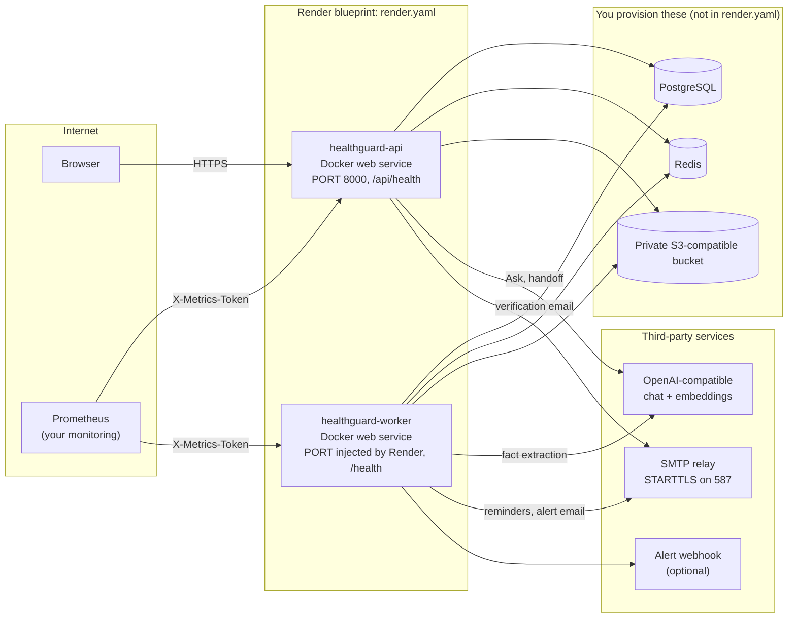
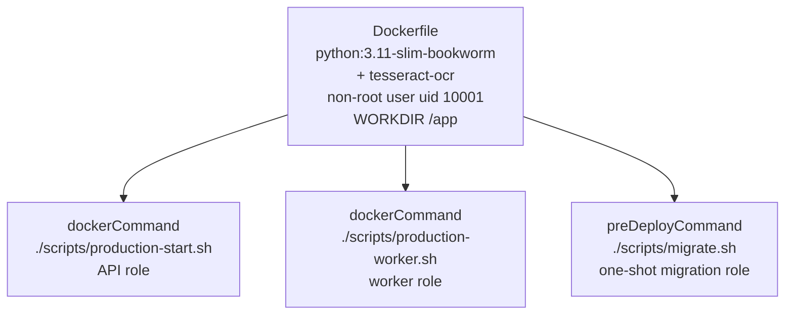
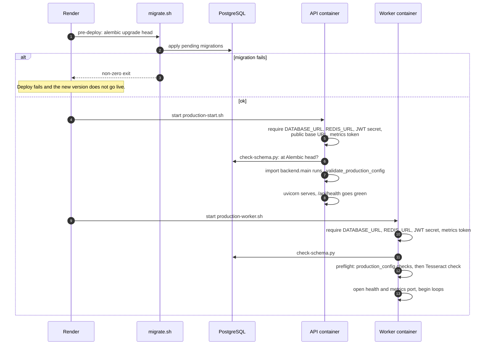
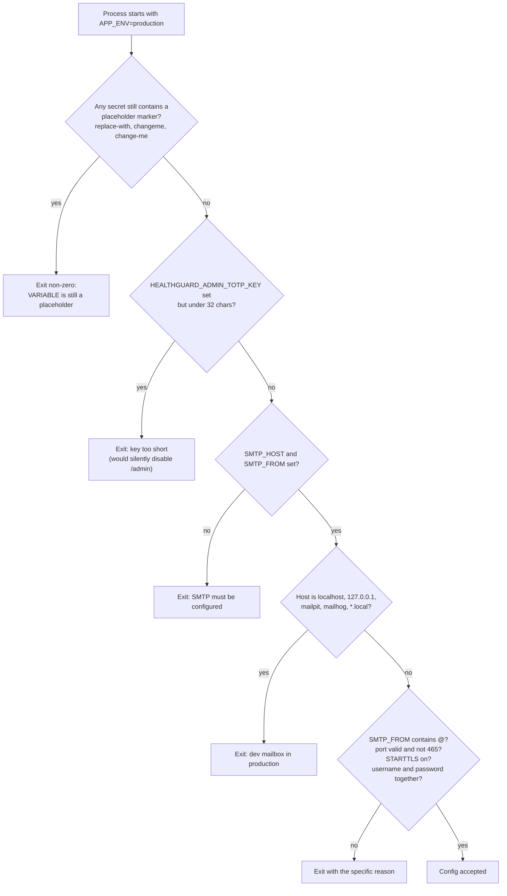
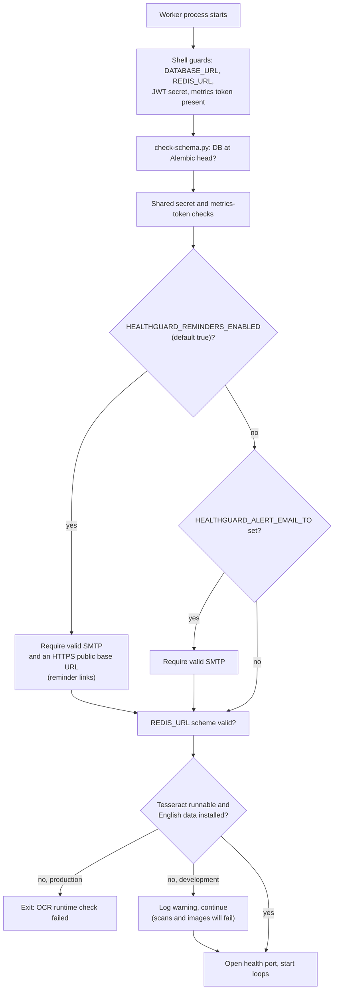
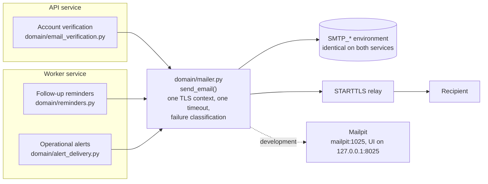
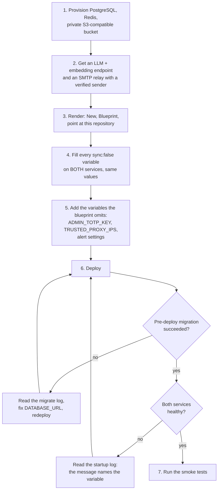
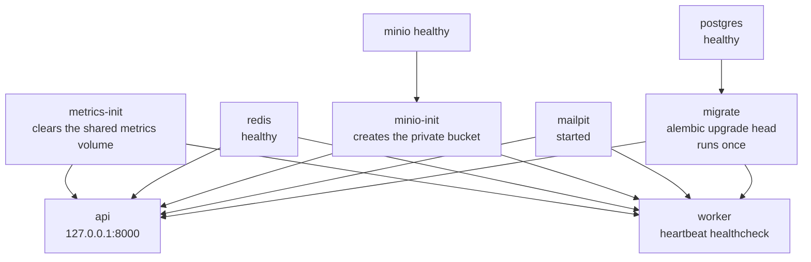

# HealthGuard deployment guide

How HealthGuard is packaged and started, what stops it from starting, and what you must do yourself. It describes this build (migration head `0018`) and is
written against the files in the repository: `Dockerfile`, `render.yaml`, `docker-compose.yml`, `scripts/*.sh`, `utils/production_config.py` and
`backend/main.py`. [`../deploy/PRODUCTION.md`](../deploy/PRODUCTION.md) is the short checklist; this is the explanation behind it.

> **Read this first.** A correct deployment is not the same as a launch-ready system. [`RELEASE_AUDIT.md`](RELEASE_AUDIT.md) lists seven open blockers (known
> dependency vulnerabilities, an unverified Docker build, no real-infrastructure drills, and more). Deploy to a staging environment with **synthetic data only**
> until they are closed.

## Contents

1. [What changed in this build](#what-changed-in-this-build)
2. [Topology on Render](#topology-on-render)
3. [One image, two roles](#one-image-two-roles)
4. [Boot sequence](#boot-sequence)
5. [Startup checks: what refuses to start, and why](#startup-checks-what-refuses-to-start-and-why)
6. [Configuration matrix](#configuration-matrix)
7. [Email: one sender, three callers](#email-one-sender-three-callers)
8. [Step-by-step: first deploy on Render](#step-by-step-first-deploy-on-render)
9. [Smoke tests after deploy](#smoke-tests-after-deploy)
10. [Local production-like stack (Docker Compose)](#local-production-like-stack-docker-compose)
11. [Known gaps in the blueprint](#known-gaps-in-the-blueprint)

---

## What changed in this build

This build (`HealthGuard_final_release_deploy_fixed`) is the readiness release plus a deployment-hardening pass. Each change closes a specific way the
previous package would have failed or misbehaved once deployed.

| Before | Failure it caused | Now |
|---|---|---|
| `render.yaml` used Render's native **Python** runtime | The Tesseract binary cannot be installed there, so every scanned PDF and image would fail with "OCR engine is unavailable" while the service looked healthy | Both services use `runtime: docker` and build the repository `Dockerfile`, which installs `tesseract-ocr` |
| The worker's Render service had no SMTP or public-URL variables | Reminders and alert email are sent by the **worker**; it would have had no mail configuration | The worker declares the same `SMTP_*` and `HEALTHGUARD_PUBLIC_BASE_URL` as the API |
| Misconfiguration surfaced late: at the first reminder, the first scan, the first login | A user finds out before the operator does | `utils/production_config.py` runs the same checks in the API and the worker at startup and exits non-zero |
| Three separate SMTP implementations (verification, reminders, alerts) | Verification mail had no TLS context, no timeout setting and no error classification; the three could be configured inconsistently | One `domain/mailer.py::send_email` used by all three |
| No free way to test email locally | Registration needs a verified email, so local runs were blocked without a real mail account | `docker-compose.yml` adds Mailpit, a dev mailbox that catches everything |
| CI installed no OCR runtime | OCR tests could not run in CI | `tesseract-ocr` is installed in the CI job |

New tests cover it: `tests/test_deployment_readiness.py`, `tests/p0/test_email_provider_consistency.py`, and an updated `tests/test_sprint5_phase5_release.py`
(which now asserts `runtime: docker` and `dockerCommand`, and that `runtime: python` is gone).

## Topology on Render



The worker is declared as a *web* service for one reason: Render health-checks web services over HTTP, and the worker exposes `/health` and a protected
`/metrics` on the port Render injects. It serves no user traffic.

**Who talks to what.** Only the API faces users. Only the worker sends reminders and alert email. Both read the same PostgreSQL, Redis and bucket, which is
why the shared variables must have identical values on both services.

## One image, two roles



All three roles run the same code. The script, not the image, decides the role. Relative script paths work because the image's `WORKDIR` is `/app`.

The image's own `HEALTHCHECK` probes `http://127.0.0.1:8000/api/health`, which is right for the API and wrong for the worker. Render's health check is driven by
`healthCheckPath` instead; Docker Compose overrides it for the worker with `scripts/worker-healthcheck.py` (checks the worker's Redis heartbeat key).

## Boot sequence



Two properties worth knowing:

- **Migrations run once, before traffic, and never at startup.** The API and worker only *verify* that the schema is at head and refuse to start otherwise. A
  rolling deploy therefore cannot have two processes racing to migrate.
- **Failing to start is the intended failure mode.** A container that exits non-zero shows up as a failed deploy in Render's dashboard, with the reason in
  the log (variable names, never values).

## Startup checks: what refuses to start, and why

`utils/production_config.py` is standard-library only, so it can run before any application import, and every check is a no-op unless `APP_ENV=production`.

### Checks shared by API and worker



The secrets checked for placeholders are: `HEALTHGUARD_JWT_SECRET`, `HEALTHGUARD_METRICS_TOKEN`, `HEALTHGUARD_ADMIN_TOTP_KEY`, `STORAGE_ACCESS_KEY`,
`STORAGE_SECRET_KEY`, `SMTP_PASSWORD`, `HEALTHGUARD_LLM_API_KEY` and `HEALTHGUARD_EMBEDDING_API_KEY`. The shipped `.env.example` deliberately contains
`replace-with-...` values, so copying it to production unchanged fails here instead of running with a known secret.

Port 465 is rejected on purpose: `domain/mailer.py` speaks STARTTLS on a plain connection, not implicit TLS, so 465 would hang rather than fail clearly.

### API-only checks (`backend/main.py::_validate_production_config`)

| Area | Requirement |
|---|---|
| Database | `DATABASE_URL` must be PostgreSQL |
| Storage | `STORAGE_BACKEND=s3`; endpoint must be HTTPS and not a development host; bucket and both credentials present |
| Redis | `REDIS_URL` must be `redis://` or `rediss://` with a host |
| AI provider | `HEALTHGUARD_LLM_PROVIDER=openai_compatible`; HTTPS base URL, model and key present; timeout 5 to 120 s and retries 0 to 2, both set explicitly |
| Embeddings | Provider must be `openai_compatible` with base URL, model and key; `deterministic` is rejected as test-only |
| Mail | Shared SMTP checks above |
| Metrics | Token of at least 32 characters; `PROMETHEUS_MULTIPROC_DIR`, if set, must be an absolute path |
| URLs | `HEALTHGUARD_PUBLIC_BASE_URL` must be HTTPS with no path, query or fragment; `CORS_ALLOWED_ORIGINS` explicit, no development hosts |
| Debug | `DEBUG` must be off |

### Worker-only checks (`jobs/worker.py::preflight`)



The OCR check is the one that matters most for this build: it turns "every scanned document fails later" into "the worker never starts", which an operator
sees immediately.

**Not checked by the worker:** storage and AI-provider variables. A worker with a wrong bucket or a missing LLM key starts, then fails the first document it
touches. The blueprint declares them, and the API checks them, so set them identically on both; but nothing stops you forgetting on the worker.

## Configuration matrix

`sync: false` in `render.yaml` means Render asks you for the value in the dashboard and never stores it in git. "Both" means set it on both services with the
same value.

| Variable | API | Worker | Notes |
|---|:--:|:--:|---|
| `APP_ENV=production` | set | set | Switches on every check on this page |
| `DATABASE_URL` | yes | yes | PostgreSQL only in production |
| `REDIS_URL` | yes | yes | Queue wake-ups, rate limits, worker heartbeat |
| `STORAGE_BACKEND=s3`, `STORAGE_ENDPOINT`, `STORAGE_BUCKET`, `STORAGE_ACCESS_KEY`, `STORAGE_SECRET_KEY` | yes | yes | Bucket must be private. `STORAGE_SSE=AES256` and `STORAGE_REGION` are preset |
| `HEALTHGUARD_JWT_SECRET` | yes | yes | At least 32 random characters |
| `HEALTHGUARD_METRICS_TOKEN` | yes | yes | At least 32 characters; guards `/api/ops/metrics` and the worker `/metrics` |
| `HEALTHGUARD_PUBLIC_BASE_URL` | yes | yes | HTTPS origin used in verification and reminder links |
| `SMTP_HOST`, `SMTP_FROM`, `SMTP_USERNAME`, `SMTP_PASSWORD` | yes | yes | `SMTP_PORT=587` and `SMTP_STARTTLS=true` are preset |
| `HEALTHGUARD_LLM_*` (provider, base URL, model, API key) | yes | yes | Server-side only; with a key set, owner consent gates all AI processing |
| `HEALTHGUARD_EMBEDDING_*` | yes | yes | Must be a real provider in production |
| `HEALTHGUARD_AI_TIMEOUT_SECONDS`, `HEALTHGUARD_AI_MAX_RETRIES` | preset | preset | 45 and 1; allowed ranges 5 to 120 and 0 to 2 |
| `CORS_ALLOWED_ORIGINS` | yes | n/a | Explicit HTTPS origins |
| `HEALTHGUARD_WORKER_ID` | n/a | preset | `render-worker-1`; must be unique per worker instance (heartbeat key is per id) |
| `HEALTHGUARD_ADMIN_TOTP_KEY` | optional | n/a | **Not in `render.yaml`.** Without it `/api/admin/*` returns 404 |
| `HEALTHGUARD_TRUSTED_PROXY_IPS` | recommended | n/a | **Not in `render.yaml`.** Without it all anonymous clients share one rate-limit bucket |
| `HEALTHGUARD_ALERT_WEBHOOK_URL`, `_SECRET`, `HEALTHGUARD_ALERT_EMAIL_TO` | n/a | optional | **Not in `render.yaml`.** The worker delivers alerts, so set them on the worker |
| `PROMETHEUS_MULTIPROC_DIR` | never | never | Compose only. Do not set on Render: the services do not share a filesystem |

## Email: one sender, three callers



`send_email` classifies failures without including PHI. **Permanent** (marked failed, not retried): a refused recipient, or any SMTP 5xx reply. **Transient**
(retried with backoff, see [`OPERATIONS.md`](OPERATIONS.md#reminder-delivery)): timeouts, connection errors, SMTP 4xx replies, and authentication failures. An
authentication failure is deliberately treated as transient, so a wrong `SMTP_PASSWORD` shows up as repeated retries and then `FAILED` rather than as an
instant permanent failure.

**Choosing a provider.** Any STARTTLS relay on port 587 works. With Resend over SMTP: `SMTP_HOST=smtp.resend.com`, `SMTP_PORT=587`, `SMTP_USERNAME=resend`,
`SMTP_PASSWORD=<API key>`, `SMTP_STARTTLS=true`, and `SMTP_FROM` on a domain you have verified with Resend. Delivery through a real provider has **not** been
verified from this repository; see the smoke tests.

## Step-by-step: first deploy on Render



Take a PostgreSQL backup before the first migration and before every later one. Render treats a failing pre-deploy command as a failed deploy, so the new version does not go live; it does not roll a partly applied schema back for you.

## Smoke tests after deploy

Run these before routing real traffic. Items 1 to 3 are checks the code supports directly; items 4 to 8 exercise real infrastructure that this repository has
**never** been run against, so treat a failure there as information, not as a surprise.

| # | Check | Expected | What it proves |
|---|---|---|---|
| 1 | `GET /api/health` | `200` | API process is up |
| 2 | `GET /api/ready` | `200` with `database`, `redis` and `storage` all true | In production, any false returns `503` |
| 3 | `GET /health` on the worker | `200` | Worker passed preflight, including Tesseract |
| 4 | Register a test account | Verification email arrives | Real SMTP, TLS and sender domain work |
| 5 | Upload a small **synthetic** PDF and a photo of text | Document reaches `COMPLETED`; facts appear with page and quote | Real S3 write, queue, OCR, and (with consent) the AI provider |
| 6 | Grant AI consent, then ask a question the document answers | Answer with a citation; an unanswerable question returns "not enough information" | Consent gate and grounding validator end to end |
| 7 | Set a follow-up with a reminder lead time a few minutes ahead | Reminder email arrives | Worker reminder loop and mailer |
| 8 | Scrape `/api/ops/metrics` and the worker `/metrics` with `X-Metrics-Token` | Prometheus text; `403` without the token | Metrics are protected |
| 9 | If configured, trigger **Evaluate** in the admin console | An alert is delivered to the webhook or `HEALTHGUARD_ALERT_EMAIL_TO` | Alert delivery channels |

## Local production-like stack (Docker Compose)

```bash
cp .env.example .env
docker compose up --build
```



- App at `http://127.0.0.1:8000`; **Mailpit** at `http://127.0.0.1:8025`. Register, open Mailpit, click the verification link. Nothing leaves your machine.
- Every port is bound to `127.0.0.1`.
- `DATABASE_URL`'s password must equal `POSTGRES_PASSWORD`, and `STORAGE_*` credentials must equal `MINIO_ROOT_*`; the shipped `.env.example` satisfies both.
- `HEALTHGUARD_METRICS_TOKEN` must be non-empty even in development, because the start scripts refuse an empty value.
- After changing `POSTGRES_PASSWORD`, reset the volume: `docker compose down -v`.
- Compose is the only place `PROMETHEUS_MULTIPROC_DIR` is used: API and worker share one host volume there.

## Known gaps in the blueprint

Stated plainly so none of them is discovered in production.

1. **`render.yaml` does not create PostgreSQL, Redis or the bucket.** It only references them through `sync: false` variables.
2. **Three settings are missing from the blueprint** and silently change behaviour: `HEALTHGUARD_ADMIN_TOTP_KEY` (no admin console without it),
   `HEALTHGUARD_TRUSTED_PROXY_IPS` (shared rate-limit bucket behind Render's proxy; the start script warns), and the alert variables (alerts stay visible only
   in the admin console).
3. **The worker does not validate storage or AI variables** at startup (see above).
4. **Single worker, fixed id.** The blueprint runs one worker as `render-worker-1`. If you add instances, give each a distinct `HEALTHGUARD_WORKER_ID`.
   Multi-worker recovery was never drilled.
5. **Instance type matters.** The worker loop only runs while the service is running. Choose an always-on instance type for both services; an instance that
   idles out would stop reminders, alerts and document processing.
6. **API docs are exposed.** `/docs`, `/redoc` and `/openapi.json` are served; the code does not disable them in production. They contain no patient data, but
   they publish your route map. Disable them (`docs_url=None, redoc_url=None, openapi_url=None` on the `FastAPI(...)` constructor in `backend/main.py`) if
   that matters to you.
7. **CI will fail its security job on the current pins.** `.github/workflows/ci.yml` runs `pip-audit -r requirements.txt`, and the audit report records 199
   known vulnerabilities in the pinned set (blocker B1). That job is red until the dependency upgrade is adopted and tested. The workflow has also never run on
   GitHub Actions.
8. **Unpinned dev images.** `mailpit` and `minio` use `:latest` in `docker-compose.yml`. Pin them for reproducible local runs.
9. **The Docker image has never been built here** (blocker B2). The first `docker build` is part of your first deploy.
