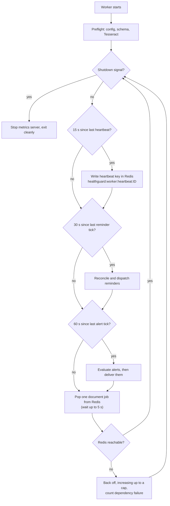
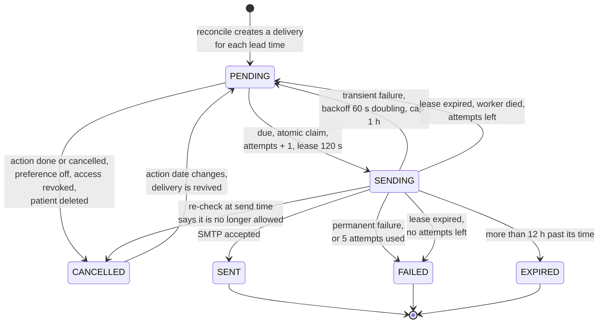
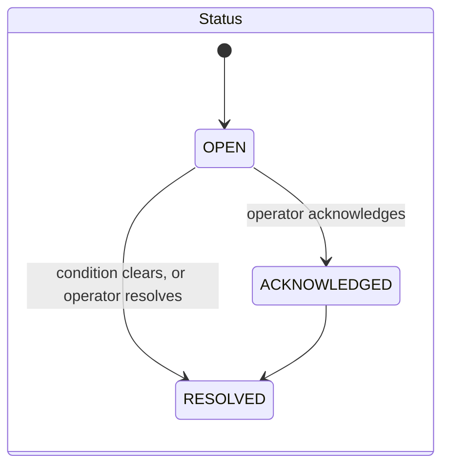
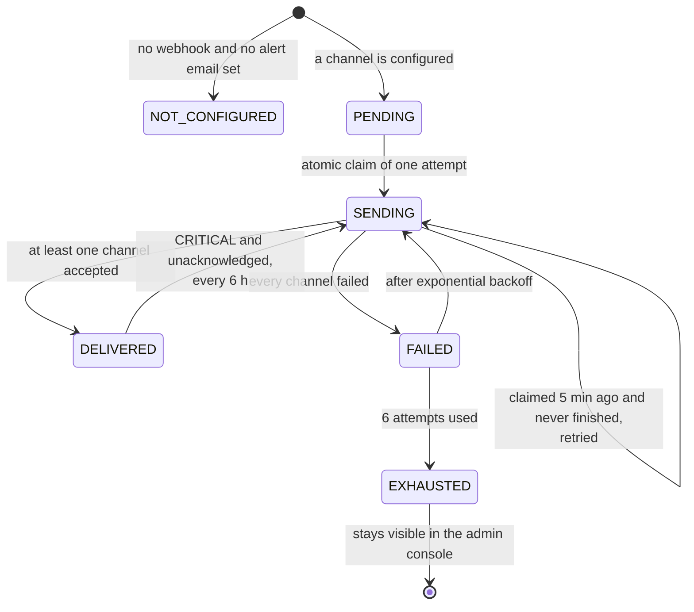
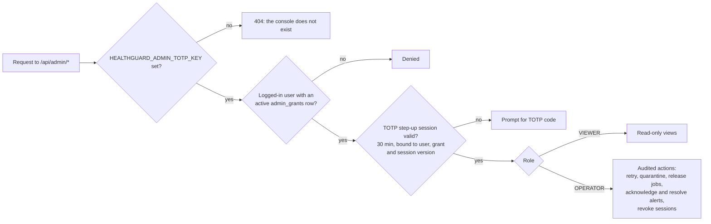
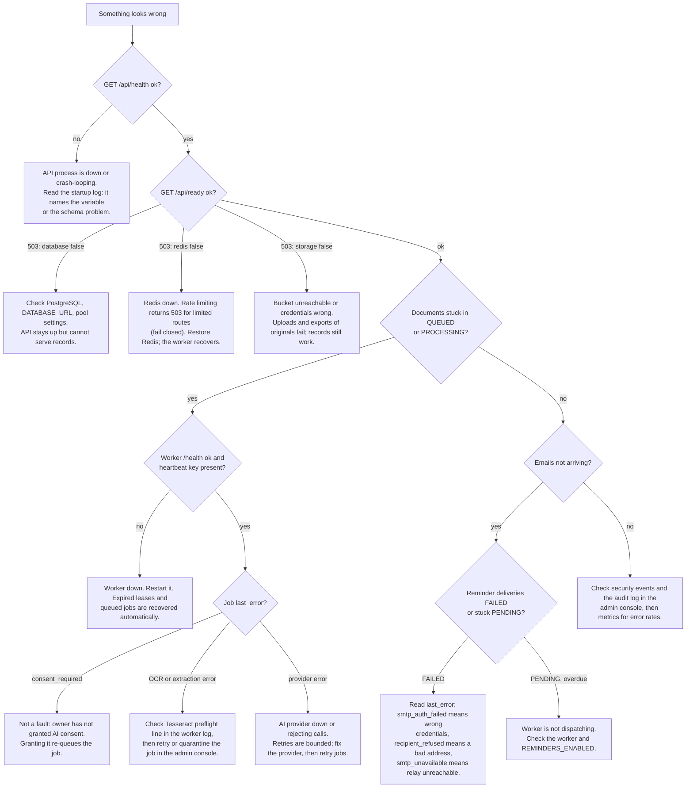

# HealthGuard operations guide

How to run HealthGuard once it is deployed: what to watch, what the background worker does on a timer, how reminders and alerts are delivered and what
happens when they fail, who can use the admin console, and what to do when something breaks. Figures and defaults are taken from the code
(`jobs/worker.py`, `domain/reminders.py`, `domain/alert_delivery.py`, `domain/admin_ops.py`); environment variables can override them. For deployment see
[`DEPLOYMENT.md`](DEPLOYMENT.md); for design rationale see [`ARCHITECTURE.md`](ARCHITECTURE.md).

## Contents

1. [Health and metrics endpoints](#health-and-metrics-endpoints)
2. [What the worker does](#what-the-worker-does)
3. [Document jobs](#document-jobs)
4. [Reminder delivery](#reminder-delivery)
5. [Alerts](#alerts)
6. [Admin console access](#admin-console-access)
7. [Incident decision tree](#incident-decision-tree)
8. [Backup and recovery](#backup-and-recovery)
9. [Logs and what they never contain](#logs-and-what-they-never-contain)

---

## Health and metrics endpoints

| Endpoint | Service | Meaning | Auth |
|---|---|---|---|
| `GET /api/health` | API | The process is alive. Does not touch dependencies | none |
| `GET /api/ready` | API | Database, Redis and storage checked with bounded timeouts. **In production, all three must pass or the status is `503`**; in development only the database must | none |
| `GET /api/ops/metrics` | API | Prometheus exposition for the API process | `X-Metrics-Token`; `403` otherwise |
| `GET /health` | Worker | The worker process is alive and passed its startup checks | none |
| `GET /metrics` | Worker | Prometheus exposition for the worker process | `X-Metrics-Token`; `403` otherwise |

`/api/health` and `/api/ready` are different on purpose. Use health for "restart me" decisions and readiness for "send me traffic" decisions: a Redis outage
should take the API out of rotation without making an orchestrator kill a perfectly healthy process.

On Render the API and worker are separate services with separate filesystems, so scrape them as **two targets**. Only Docker Compose shares a metrics volume
between them (`PROMETHEUS_MULTIPROC_DIR`).

## What the worker does

The worker is one loop that interleaves four jobs. It must be running for any of them to happen.



| Duty | Default period | Setting |
|---|---:|---|
| Heartbeat | 15 s | `HEALTHGUARD_WORKER_HEARTBEAT_SECONDS` |
| Reminder reconcile and dispatch | 30 s | `HEALTHGUARD_REMINDER_TICK_SECONDS` |
| Alert evaluation and delivery | 60 s | `HEALTHGUARD_ALERT_CYCLE_SECONDS` |
| Document job claim | continuous, 5 s poll | n/a |

A Redis outage does not stop the worker: it keeps looping, counts the failure, and resumes when Redis returns. `SIGTERM` and `SIGINT` finish the current
iteration and exit cleanly, which is what a Render redeploy sends.

## Document jobs

Job lifecycle and the document state machine are in [`ARCHITECTURE.md`](ARCHITECTURE.md#document-processing-pipeline). Operationally:

| Setting | Default | Effect |
|---|---:|---|
| `HEALTHGUARD_JOB_LEASE_SECONDS` | 120 | How long a claimed job is owned before it can be recovered |
| `HEALTHGUARD_JOB_MAX_ATTEMPTS` | 3 | Attempts before a job is failed for good ("poisoned") |
| `HEALTHGUARD_JOB_BACKOFF_SECONDS` | 5 | Base delay before a transient failure is retried |
| `HEALTHGUARD_QUEUE_VISIBILITY_SECONDS` | 120 | Redis in-flight visibility window |

The admin console can **retry**, **quarantine** and **release** a job. Quarantine takes a job out of circulation without deleting it, which is the right
move for a document that crashes the worker every time.

Recovery is automatic: a job whose lease expired is put back in the queue with `worker_lease_expired`, or failed with `lease_expired_max_attempts` once the
attempt budget is spent. A document whose record was deleted in the meantime is failed with `document_unavailable` instead of being processed.

## Reminder delivery

Users opt in per patient profile; only follow-ups with an **exact** date that the user created or confirmed are reminded. Reminders carry no health details
unless the user allowed the title in the email. Rules and opt-in API are in [`../deploy/PRODUCTION.md`](../deploy/PRODUCTION.md#email-reminders-follow-ups).



Properties that matter in practice:

- **Authorization is re-checked at send time.** A grantee whose access was revoked, or whose `HEALTH_ACTIONS` scope was removed, never receives a reminder
  that was scheduled before the change.
- **Delivery is at-least-once.** A crash between SMTP accepting the message and the database recording `SENT` can cause one duplicate. Each message carries a
  deterministic `Message-ID` (`<reminder-{delivery id}@host>`) so a duplicate can be recognised.
- **Concurrent workers are safe.** The `PENDING` to `SENDING` claim is one atomic update.
- **A wrong SMTP password retries, then fails.** Authentication errors are classed as transient, so expect repeated retries and a `FAILED` after five
  attempts rather than an immediate failure.

Settings: `HEALTHGUARD_REMINDER_MAX_ATTEMPTS` (5), `_BACKOFF_SECONDS` (60), `_LEASE_SECONDS` (120), `_MAX_LATENESS_HOURS` (12), `HEALTHGUARD_REMINDERS_ENABLED`
(true).

## Alerts

Alerts are **derived from real conditions every 60 seconds**, not entered by hand. An alert disappears (auto-resolves) when its condition stops being true.

### What raises an alert

| Fingerprint | Severity | Condition |
|---|---|---|
| `jobs.failed` | WARNING, CRITICAL at 5 or more | One or more document jobs are in `FAILED` |
| `jobs.stale` | WARNING | A job holds an expired lease (worker may have died) |
| `jobs.poisoned` | CRITICAL | A job exhausted all attempts and is not quarantined |
| `jobs.quarantined` | INFO | Jobs are quarantined |
| `redis.down` | CRITICAL | Redis unreachable |
| `queue.depth` | WARNING | Waiting jobs exceed `HEALTHGUARD_ALERT_QUEUE_DEPTH` (100) |
| `workers.none` | CRITICAL | Jobs are waiting or in flight but no worker heartbeat exists |
| `storage.down` | CRITICAL | Object storage health check fails |
| `db.migration` | CRITICAL | Schema is not at the Alembic head |
| `ai.not_configured` | WARNING | Production with no AI provider configured |
| `reminders.failed` | WARNING | Any reminder email failed in the last 24 h |
| `reminders.overdue` | WARNING | A reminder is more than 1 h overdue (worker may not be dispatching) |
| `security.auth_spike` | WARNING | `HEALTHGUARD_ALERT_AUTH_FAILURES_15M` (20) or more authentication failures in 15 minutes |

Note the self-monitoring: `workers.none` and `reminders.overdue` both fire when the worker is the thing that is broken. But the alert *loop itself* runs
inside the worker, so if **every** worker is down, nothing evaluates and nothing is delivered. Alert on the worker's absence from outside the application
(for example an external uptime check on the worker `/health`, or a Prometheus rule on the heartbeat) as well.

### How an alert is delivered

Two independent fields describe an alert: its **status** (what the operator did) and its **delivery state** (whether anyone was told).





| Setting | Default | Effect |
|---|---:|---|
| `HEALTHGUARD_ALERT_WEBHOOK_URL` | unset | HTTPS in production; redirects are never followed |
| `HEALTHGUARD_ALERT_WEBHOOK_SECRET` | unset | If set, the body is HMAC-SHA256 signed: `X-HealthGuard-Signature` over `<timestamp>.<body>`, with `X-HealthGuard-Timestamp` |
| `HEALTHGUARD_ALERT_EMAIL_TO` | unset | Comma-separated recipients, sent through the shared `SMTP_*` sender |
| `HEALTHGUARD_ALERT_MIN_SEVERITY` | WARNING | Alerts below this are never sent |
| `HEALTHGUARD_ALERT_MAX_ATTEMPTS` | 6 | Then `EXHAUSTED` |
| `HEALTHGUARD_ALERT_REPEAT_HOURS` | 6 | Repeat interval for unacknowledged CRITICAL alerts |
| `HEALTHGUARD_ALERT_TIMEOUT_SECONDS` | 5 | Per-channel request timeout |

With neither channel configured nothing is sent and nothing is pretended: `delivery_state` stays `NOT_CONFIGURED`, and alerts exist only in the admin
console. Undelivered alerts are also exported as the metrics `healthguard_alerts_undelivered` and `healthguard_alert_oldest_undelivered_age_seconds`, so a dead webhook can be alerted on from Prometheus rather than hiding silently.

**Payloads contain alert text only**: counts and component names. Never patient data, email addresses or job error text.

## Admin console access

The console at `/admin` is default-deny. There is no way to create an admin through the API; it is provisioned offline.



Provision from a shell that has `DATABASE_URL` and `HEALTHGUARD_ADMIN_TOTP_KEY`:

```bash
python scripts/admin.py grant <username> --role OPERATOR   # prints the TOTP provisioning URI once
python scripts/admin.py list
python scripts/admin.py revoke <username>
```

On Render, run these from a one-off shell on the API service so the environment is already set. The console shows operational data only (jobs, health,
alerts, security events, masked account metadata). There is no admin route to patient data, and a test asserts the admin router imports no patient models.

## Incident decision tree



## Backup and recovery

| Data | Authority? | Backup | If lost |
|---|---|---|---|
| PostgreSQL | **Yes**, system of record, including every job row | Provider automated backups plus periodic `pg_dump`; rehearse restores into an isolated instance | Restore the database **before** starting workers so job rows stay authoritative |
| Object storage | Yes, original files | Versioning or replication per your retention policy; never a public bucket | Records survive; original files and ZIP exports are unavailable |
| Redis | **No**, recoverable delivery state | None needed | Restart Redis and workers; queued and retryable jobs are re-enqueued from PostgreSQL and stale leases are recovered |

Take a backup before every migration. Migrations run once, before traffic; a failed one leaves the API out of service until the database is reconciled from a
verified backup.

**What has not been exercised:** restore from backup, rollback beyond the PostgreSQL migration round-trip test, PostgreSQL pool exhaustion, and multi-worker
crash recovery. The design supports them; no drill has proved them. Schedule at least a restore rehearsal before real use.

## Logs and what they never contain

Logs are structured JSON and deliberately PHI-free: ids and counts, never question text, document text, answers, prompts, model output, tokens, cookies or
credentials. The audit log follows the same rule. Configuration errors name the *variable*, never its value. If you add a log line, keep to that rule; it is
the reason these logs can be shipped to a third-party aggregator.
