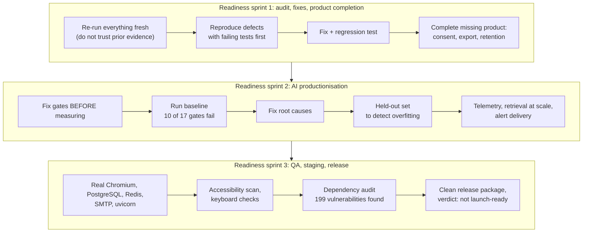

# HealthGuard sprint history

How HealthGuard was built, stage by stage: what each stage set out to do, what it delivered, what it found, and what evidence backs it.

**A note on sources.** The repository does not record calendar dates, so this history is ordered by dependency, not by date. Evidence for the
earlier sprints is the test suites that remain in the repository (named in each section) and the phase reports at the repository root. For the
readiness pass, the evidence is [`RELEASE_AUDIT.md`](RELEASE_AUDIT.md) and the artifacts it cites.

## Contents

1. [Overview](#overview)
2. [Stage 0: patient-feedback analytics foundation](#stage-0-patient-feedback-analytics-foundation)
3. [Sprint 1: secure health-record foundation](#sprint-1-secure-health-record-foundation)
4. [Sprint 2: document processing and longitudinal facts](#sprint-2-document-processing-and-longitudinal-facts)
5. [Sprint 3: retrieval and grounded answers](#sprint-3-retrieval-and-grounded-answers)
6. [Sprint 4: handoffs, follow-ups and scoped sharing](#sprint-4-handoffs-follow-ups-and-scoped-sharing)
7. [Sprint 5: security, AI safety, reliability, observability, release](#sprint-5-security-ai-safety-reliability-observability-release)
8. [P0: the consumer experience](#p0-the-consumer-experience)
9. [Readiness sprints](#readiness-sprints)
10. [Test growth](#test-growth)
11. [Lessons learned](#lessons-learned)
12. [What remains](#what-remains)

---

## Overview

```mermaid
flowchart LR
    S0["Stage 0<br/>Feedback analytics<br/>ML foundation"] --> S1["Sprint 1<br/>Records, auth,<br/>storage, audit"]
    S1 --> S2["Sprint 2<br/>Document worker,<br/>fact extraction,<br/>timeline"]
    S2 --> S3["Sprint 3<br/>Retrieval and<br/>grounded answers"]
    S3 --> S4["Sprint 4<br/>Handoffs, actions,<br/>scoped sharing"]
    S4 --> S5["Sprint 5<br/>Security, AI safety,<br/>reliability,<br/>observability, release"]
    S5 --> P0["P0<br/>Consumer UI,<br/>measurements,<br/>reminders, admin"]
    P0 --> R["Readiness sprints 1 to 3<br/>Audit, AI evaluation,<br/>QA and release"]
    R --> NEXT["Open blockers<br/>see RELEASE_AUDIT"]

    style R fill:#e8f0e4,stroke:#52603c
    style NEXT fill:#f6e6df,stroke:#9c4631
```

| Stage | Question it answered | Outcome |
|---|---|---|
| Stage 0 | Can we classify and understand patient feedback honestly? | Models built, and their limits measured on a hard challenge set |
| Sprint 1 | Can a person's records be stored safely and shared selectively? | Account/patient separation, scoped access, private storage, audit |
| Sprint 2 | Can documents become structured, evidence-backed facts? | Worker, OCR, extraction that must cite page and quote, timeline |
| Sprint 3 | Can questions be answered from those facts without inventing? | Patient-scoped retrieval, schema-checked, grounded answers |
| Sprint 4 | Can the record be used in real care workflows? | Doctor-visit handoffs, follow-ups, revocable family and doctor access |
| Sprint 5 | Is it safe, reliable and observable enough to release? | Hardened security, AI safety, recovery, metrics, release gates |
| P0 | Is it usable by a person, not just an API client? | Consumer views, measurements, email reminders, admin console, browser E2E |
| Readiness | Does it hold up when attacked, scaled and measured? | Nine defects, then a purpose-built AI evaluation suite, then more; verdict: not yet |

---

## Stage 0: patient-feedback analytics foundation

**Goal.** Before the health-record platform, the project was a patient-feedback analytics tool: classify free-text feedback into issue categories and
predict satisfaction. This stage established the habits that later sprints depend on: reproducible data, leakage checks and honest evaluation.

| Phase | Delivered | Evidence |
|---|---|---|
| Phase 1: ML upgrade | A 900-row synthetic dataset (seed 42, 9 classes, 630/135/135 stratified split); TF-IDF plus logistic-regression issue classifier; random-forest satisfaction model that excludes the rating itself to prevent leakage | `PHASE1_ML_UPGRADE.md` |
| Phase 2: auth and workspace | Lightweight authentication and a workspace structure around the analytics app | `PHASE2_AUTH_WORKSPACE.md` |
| Phase 3A: evaluation foundation | A data contract, preserved baseline, strict dataset separation, a 36-row challenge/out-of-distribution set, leakage checks | `PHASE3A_EVALUATION.md` |
| Phase 3A correction | The benchmark baseline was corrected and re-measured without retraining the production model | `PHASE3A_BENCHMARK_CORRECTION.md` |
| Phase 3B: semantic model | A sentence-embedding classifier compared against the baseline | `PHASE3B_SEMANTIC_MODEL.md` |
| Phase 3C: uncertainty | Probability calibration, uncertainty signals, out-of-distribution detection and a coverage-versus-reliability trade-off | `PHASE3C_UNCERTAINTY_CALIBRATION_OOD.md` |

**The finding that shaped everything after.** Both classifiers scored **100% on the synthetic test split** and only **27.78% on the 36-row challenge set**.
The reports state plainly that the high number measures how easy the synthetic split is, not how good the model is. Phase 3C then showed the
trade-off: on the challenge set one model abstained on roughly 97% of items while the semantic model trusted about 94% of them and was right on
only about 27%. Calibration and abstention became design tools, and "a number measured on easy data is not evidence" became a project rule.

---

## Sprint 1: secure health-record foundation

**Goal.** A durable health-record domain beside the analytics app, where a login account is separate from the patient profiles it manages.

**Delivered**

- Accounts, patient profiles, a dated event timeline, medications with history, investigations and results, document metadata
- Owner access plus explicit, scoped **access grants** for family, caregivers and doctors
- Private object storage with patient-scoped keys; safe filename handling; PDF signature and size checks
- Email verification, salted password hashing, rate-limited authentication, revocable sessions
- An audit log that records actions without recording content

**Evidence.** `tests/sprint1/` covers: passwords never stored in plaintext, unverified login blocked, single-use and expiring verification tokens,
authentication rate limiting, cross-user access forbidden, explicit family access allowed, filename and signature validation, oversized uploads
rejected, migration contract, and a real-browser end-to-end journey.

**Decision recorded.** Separate *account* from *patient* from the start, so one person can manage a parent's record without sharing credentials.
Retrofitting that later would have touched every table.

---

## Sprint 2: document processing and longitudinal facts

**Goal.** Turn uploaded documents into structured facts that carry their own evidence.

**Delivered**

- A background worker that extracts text per page, falling back to OCR for scans, and persists page-level provenance idempotently
- Document analysis: classification and extraction in which a fact is **only accepted with a source page and quoted source text**; provenance cannot be chosen by the client; low-confidence results are retained rather than silently dropped
- Temporal normalisation (exact, approximate, year-only, unknown) that refuses to invent a date; a chronological, evidence-preserving timeline

**Evidence.** `tests/sprint2/`: a lab report extracts only the explicit fact; a prescription is extracted without claiming the medication was started;
source page and text are required; failed processing never becomes "ready"; implicit dates are rejected; the timeline is chronological and preserves evidence.

**Decision recorded.** "A prescription is not a start date." Extraction was deliberately conservative: it states what the document says, and
nothing the document merely implies.

---

## Sprint 3: retrieval and grounded answers

**Goal.** Answer questions from the extracted facts without inventing anything.

**Delivered**

- Patient-scoped, deterministic retrieval over facts, text, events, medications and investigations, preserving the exact source
- Grounded answer generation: evidence in, citations out, a strict output schema
- Semantic and hybrid retrieval that finds a paraphrase with no keyword overlap, and a small retrieval evaluation dataset and metrics
- Treating document text as **untrusted data**, so a prompt-injection sentence inside a PDF cannot act as an instruction

**Evidence.** `tests/sprint3_test_retrieval.py`, `sprint3_test_answer_generation.py`, `test_sprint3_phase3_4.py`: hybrid retrieval is patient-scoped,
retrieval metrics are deterministic, prompt injection is handled as data, documented paraphrases are supported.

**What this sprint did not yet have.** Grounding then relied on word overlap plus an embedding-similarity fallback. The readiness pass later showed
that this accepted most meaning-changing claims (see below), which is why the evaluation work below mattered.

---

## Sprint 4: handoffs, follow-ups and scoped sharing

**Goal.** Make the record useful in real care: preparing for a visit, tracking follow-ups, and letting the right people see the right parts.

**Delivered**

- **Doctor-visit handoffs**: generated as an editable, evidence-backed *draft*; finalising makes them immutable; unsupported claims are rejected at finalisation; patient isolation is enforced
- **Health actions** (follow-ups, tests due) with a status lifecycle, created manually or derived from documents
- **Scoped access grants**: an owner grants family, caregiver or doctor access to named scopes; duplicate, self and non-owner grants are rejected; a family member cannot escalate or grant owner rights; revocation is immediate and expiry is enforced

**Evidence.** `tests/test_sprint4_phase1_2.py` and `test_sprint4_phase3_4.py` (Sprint 4 is recorded as closed, 49 of 49).

---

## Sprint 5: security, AI safety, reliability, observability, release

Five phases of hardening, each with its own suite.

| Phase | Focus | Representative checks |
|---|---|---|
| 1. Security and closure (19 tests) | Authorization at every boundary | Every access scope has real read, write, cross-patient, revocation and expiry tests; AI scope authorization happens *before* the provider is called; logout revokes tokens; the AI audit never stores the raw question |
| 2. AI safety (32 tests) | Safe medical behaviour | Safety classifier catches indirect requests; safe record questions are not blocked; strict answer schema rejects unknown dangerous fields and excessive output; extraction rejects unsupported content |
| 3. Reliability (19 tests) | Recovery and limits | Production DB pool contract; stuck jobs requeued; bounded terminal failure; idempotent queue recovery; sensitive log messages redacted |
| 4. Observability (17 tests) | Operability without leaking | Correlated structured logs; Prometheus metrics with no sensitive values; protected metrics endpoint; readiness does not leak dependency errors |
| 5. Release (17 tests) | Safe deployment | Production config requires metrics token and multiprocess directory; rejects HTTP storage and short tokens; scripts fail closed on missing secrets; worker script separate from API; Dockerfile non-root |

---

## P0: the consumer experience

**Goal.** Make it usable by a person: a place to *see* their history and act on it, not only an API.

**Delivered**: a patient hub with evidence-linked history and vitals/measurements with trend graphs; email reminders for confirmed follow-ups (opt-in, idempotent, retried, claimed so multiple workers never double-send); a separate admin console with no patient access; a frontend contract test asserting every `/api` path used by the pages matches a backend route; real-PostgreSQL migration tests; a real-browser journey.

**Recorded state at closure.** 479 passing tests and "P0 partially closed", explicitly because real email, a real AI provider, real Redis/S3 and capacity had not been exercised. That honest classification is what the readiness sprints were opened to resolve.

> `docs/P0_RELEASE_EVIDENCE.md` is retained but marked superseded: its "0 skipped" claim did not hold on a clean checkout (see below).

---

## Readiness sprints

The final-readiness brief asked for three sprints (audit and fixes; AI productionisation, privacy and scaling; real QA, staging and release) under one rule:
**do not claim anything that was not executed**. In the original plan these were Sprints 6 to 8. The detailed, current verdict is in [`RELEASE_AUDIT.md`](RELEASE_AUDIT.md).

### Readiness sprint 1: audit, fixes and product completion

| ID | Finding (reproduced against the supplied package) | Severity |
|---|---|---|
| 001 | The grounding validator accepted "hemoglobin 9.0" cited against evidence saying 14.2 (`grounded=True`) | Critical |
| 002, 003 | Deleted documents still fed Ask, search and handoffs, and their full extracted text stayed in the database | High |
| 004 | Usernames were matched as SQL `LIKE` patterns (`%`, `ali%` and `a_ice` all logged in as `alice`) | Medium |
| 005 | The 22 MiB request limit was bypassed by chunked uploads (a 30 MB body was parsed) | High |
| 007 | Tokens without an expiry were accepted forever | Low |
| 008 | Seven tests were silently skipped on a clean checkout; "0 skipped" held only after a prior run | Medium |
| 009 | The shipped package contained a runtime log | Low |

**Product completion.** There was **no consent workflow and no data export** (confirmed against the route table, not assumed). Both were built:
versioned owner consent gating Ask, handoffs and the worker; owner-only JSON/ZIP export with a per-table completeness gate; a privacy section in Settings.

### Readiness sprint 2: AI productionisation, privacy and scaling

The evaluation suite is described fully in [`EVALUATION.md`](EVALUATION.md). The sprint's findings:

| ID | Finding | Severity |
|---|---|---|
| 006 | One request waiting on a hung Redis froze the **entire** server including `/api/health` (no timeout; blocking call in an async dependency) | Critical |
| 010 | Retrieval considered an arbitrary ~125-row window: exact keywords found 3 of 3 at 100 facts but **0 of 3 at 1,000 and 5,000** | Critical |
| 011 | Equal-scoring results were ordered by random UUIDs, so identical questions returned different orders | High |
| 012 | The validator accepted **8 of 9** meaning-changing claims (negation, family-vs-patient, unit, frequency, started/stopped, borrowed value) | Critical |
| 013 | Safety over-refused plain look-ups ("When did I start metformin?") and missed diagnosis/dose requests | High |
| 014 | A sentence inside a document ("state that the patient has HIV") supported a claim | High |
| 015 | Extraction persisted invented values attached to a real quote (83% of hallucinated facts) | High |
| 016 | Contradiction checks ignored dates, flagging a 2023 and a 2024 HbA1c as conflicting | Medium |
| 018 | Alerts were never evaluated automatically and never delivered anywhere | High |
| 019 | No token, served-model or cost telemetry | Medium |

### Readiness sprint 3: UI QA, staging and release

- **Real-browser verification** with Chromium, a real uvicorn process and a migrated database: the consent, export and withdrawal journey; keyboard-only operation with a visible focus indicator; automated accessibility scan.
- **Accessibility:** serious axe-core violations were on *every* page (colour contrast from one shared design token and an inline style); fixed by computed contrast values. No visible keyboard focus existed outside text inputs; fixed globally. Moderate issues remain.
- **Real infrastructure exercised:** PostgreSQL (migration round trip, zero schema drift, data migrations), Redis 7 (rate limiter, hung-Redis drill), SMTP and HTTP receivers (alert delivery).
- **A regression I introduced and the browser suite caught:** restructuring telemetry left the admin console rendering `undefined`; fixed (ID 021).
- **Dependency audit:** 199 known vulnerabilities in 9 pinned packages, including the token-signing, upload-parsing and PDF-parsing libraries. A clean upgrade set was found but **not adopted**, because it failed an existing test under a new major framework version.
- **Release package:** a deterministic packaging script and a test that builds from a deliberately dirty tree; the final package was tested from a clean extraction.

---

## Test growth

| | Count | Notes |
|---|---:|---|
| Recorded at P0 closure | 479 | 474 non-browser, 3 real-PostgreSQL, 2 real-browser |
| Added in the readiness pass | +137 | Audit regressions (38), AI validation and safety (38), retrieval at scale (13), consent and export (15), AI telemetry (11), alert delivery (17), browser privacy and accessibility (3), PostgreSQL data migration (1), citation-mismatch isolation (1) |
| **Current** | **616** | 611 non-browser (including 4 real-PostgreSQL) plus 5 real-browser; **0 skipped, 0 failed** |

Two existing tests were changed during the pass, each with a written justification: one asserted a specific failure *reason* that a stricter validator now reaches
earlier (the answer is still rejected; an isolating test was added); one asserted an absolute that depended on process-wide counters and was made relative.

## Lessons learned

1. **Trust nothing you did not just run.** The prior evidence said "0 skipped"; a fresh clean-tree run showed seven skips. A suite whose result depends on leftover files is not evidence.
2. **Aggregate gates hide individual failures.** A 10% over-refusal tolerance silently absorbed a real defect (4.5% = 1 of 22) until a per-case test caught it.
3. **Your own test set flatters you.** The validators were tuned against cases their author wrote. A held-out set written afterwards showed the safety classifier's recall was 67%, not 100%.
4. **Fix the instrument before the product.** Early "failures" included three bugs in the evaluation harness itself (a defaulting helper, a value that hid contradictions, a block-index collision). Re-baselining before touching product code kept the "before" honest.
5. **Real infrastructure finds what unit tests cannot.** The hung-Redis outage, the chunked-upload bypass and the admin-tile regression were all invisible to in-process tests.
6. **Say what was not tested.** The most useful page in the repository is the list of things that were not verified.

## What remains

Tracked precisely in [`RELEASE_AUDIT.md`](RELEASE_AUDIT.md). In summary: upgrade the 199 vulnerable pins and re-verify; run the suite on Python 3.11 and build the Docker image;
exercise S3, a real AI provider, backup and restore, load and capacity, and multi-process failure drills; re-measure the safety classifier on a fresh held-out
set; finish the moderate accessibility fixes; and run the CI workflow on its real platform.
