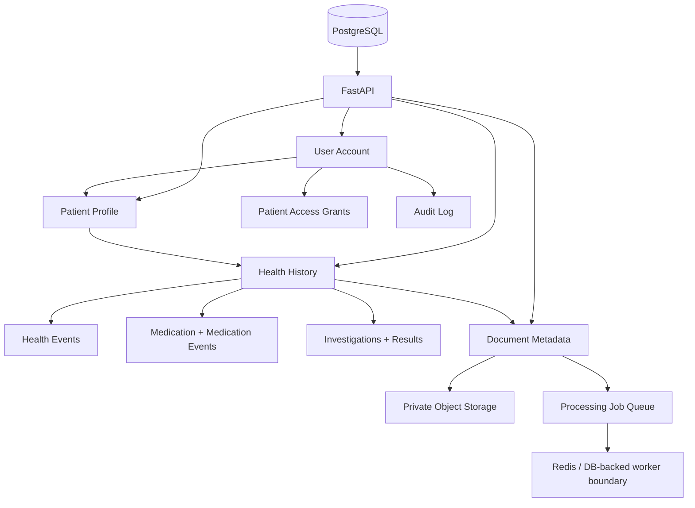

> **Archived:** the original Sprint 1 README, kept because its API listing and operational rules are still accurate. The current overview is the repository `README.md`.


## HealthGuard Sprint 1 — Secure Health Continuity Foundation

Sprint 1 adds a durable health-record domain alongside the existing patient-feedback analytics application. A login account is separate from one or more patient profiles, and patient access is controlled at the object level.

### Architecture



### Security model

Every patient-scoped operation checks both authentication and the relationship between the authenticated account and the requested patient. Owners have full access; explicitly granted family/caregiver access is represented in `patient_access`. Medical files are never served from a public bucket. S3 deployments use private objects and short-lived presigned URLs; local development uses a private filesystem directory.

Passwords are stored using salted PBKDF2-HMAC-SHA256 hashes. JWTs contain only the user identifier and expiry. Sensitive actions create audit records without document contents or passwords.

### Sprint 1 setup

```bash
cp .env.example .env
alembic upgrade head
uvicorn backend.main:app --reload
```

For production, use PostgreSQL, Redis, and private S3-compatible object storage. Do not use the local filesystem backend for production medical documents.

### Docker

```bash
docker compose up --build
```

The compose stack provides PostgreSQL, Redis and MinIO for local production-like integration testing.

### Health APIs

- `POST /api/patients`
- `GET /api/patients`
- `GET/PATCH/DELETE /api/patients/{patient_id}`
- `POST/GET /api/patients/{patient_id}/events`
- `PATCH/DELETE /api/events/{event_id}`
- `POST/GET /api/patients/{patient_id}/medications`
- `POST /api/medications/{medication_id}/events`
- `POST/GET /api/patients/{patient_id}/investigations`
- `POST/GET /api/patients/{patient_id}/documents`
- `GET /api/documents/{document_id}`
- `GET /api/documents/{document_id}/content`
- `DELETE /api/documents/{document_id}`
- `POST/DELETE /api/patients/{patient_id}/family/...`
- `POST /api/account/deactivate`
- `DELETE /api/account`

Sprint 1 deliberately does not perform OCR, LLM extraction, RAG, diagnosis, medical-result interpretation, treatment recommendations, or autonomous clinical decisions. Uploaded documents end in `QUEUED` status so Sprint 2 can attach the AI worker without changing the upload contract.

### Sprint 1 hardening limits and operational rules

- Collection endpoints accept `page` (minimum 1) and `page_size` (1–100); ordering is deterministic and responses remain JSON arrays for API compatibility.
- Medical-document uploads are streamed to temporary storage and bounded by `HEALTHGUARD_MAX_DOCUMENT_BYTES` (20 MiB by default); request bodies are bounded by `HEALTHGUARD_MAX_REQUEST_BODY_BYTES` (22 MiB by default).
- Text fields use explicit server-side maximum lengths; authenticated identity, ownership, provenance, actor IDs, and timestamps are never client-controlled.
- In production, Redis-backed rate limiting fails closed if Redis is unavailable.
- Production CORS origins must be explicitly configured. Browser sessions use HttpOnly/Secure/SameSite cookies plus CSRF protection.
- Document deletion uses a durable `DELETION_PENDING` state so storage failures are retryable and are never reported as successful permanent deletion.
- Email verification tokens are hashed, expiring, one-time, and atomically consumed.

## Sprint 1 Processing Boundary

Sprint 1 persists ProcessingJob records and establishes the authorization, status, retry, and queue boundary for document processing. It does not implement an OCR/LLM/document-intelligence worker. In production, Redis is the required processing queue; a separate worker that consumes `healthguard:document_jobs` is a Sprint 2 boundary. Failed queue attempts are explicitly retryable through the API, while failed storage attempts are recoverable by retrying the same upload.

## Sprint 2 Phase 1 — Document Processing Worker

Sprint 2 Phase 1 attaches a real worker to the existing `healthguard:document_jobs` Redis queue. The worker claims each `ProcessingJob` atomically, moves it through `QUEUED → PROCESSING → COMPLETED` (the API-visible completed/READY terminal state) or `FAILED`, extracts PDF text page-by-page, falls back to OCR for image pages and scanned PDFs, and persists `DocumentTextBlock` evidence with document/page/method/confidence provenance. A completed job is idempotent: duplicate queue deliveries do not re-extract or duplicate evidence. Failed processing remains `FAILED` and is retryable only through the existing authorized retry path.

Run the worker locally with `REDIS_URL` configured:

```bash
python -m jobs.worker
```

The Docker Compose stack now runs the API and processing worker as separate services. OCR uses Tesseract through `pytesseract`; the production image installs the Tesseract runtime.

## Sprint 1 HealthGuard Product Boundary

The primary HealthGuard product surface is the personal health continuity platform served by `/`, `/workspace`, `/health`, `/patient`, and `/settings`. It covers patient profiles, historical health events, medication trajectories, investigations/results, private documents, family access, and account controls.

The repository also retains the older patient-satisfaction/analytics implementation for compatibility. Its legacy routes (`/api/analyze`, `/api/upload`, `/api/metrics`, `/api/uploads`, `/analyze`, `/insights`, `/departments`, `/models`) are intentionally not linked from the HealthGuard landing, authentication, or primary workspace navigation. They remain authenticated/owner-scoped where applicable and are documented as legacy rather than being silently presented as HealthGuard functionality.

### Sprint 1 Processing Boundary

Sprint 1 persists a `ProcessingJob` and establishes the private-document → processing-queue boundary. Production requires Redis for queue submission. A worker that consumes the queue and performs OCR, classification, extraction, or other document intelligence is intentionally deferred to Sprint 2. Failed jobs expose a retry path; Sprint 1 does not claim that document processing itself is implemented.

### Browser E2E

Install the Playwright Chromium browser before running the browser suite:

```bash
python -m playwright install chromium
```

The repository includes a Playwright browser E2E test covering registration/verification, cookie-based login, refresh, patient creation, health history, medication/events, investigation/results, document retry, family access/revocation, logout, and protected-route denial. The test uses a controlled SMTP capture and local private storage in test mode. In restricted environments where Chromium is prevented from reaching localhost by sandbox policy, the test reports an environment skip rather than falsely claiming execution.
